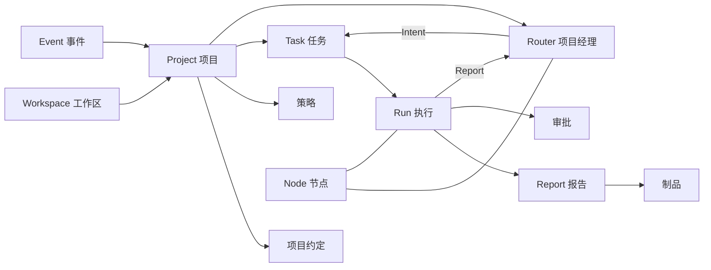
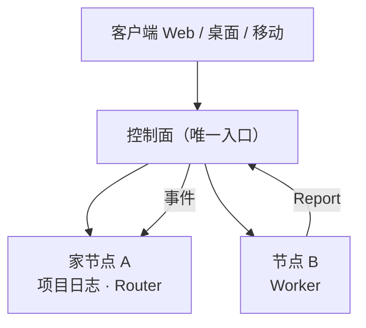
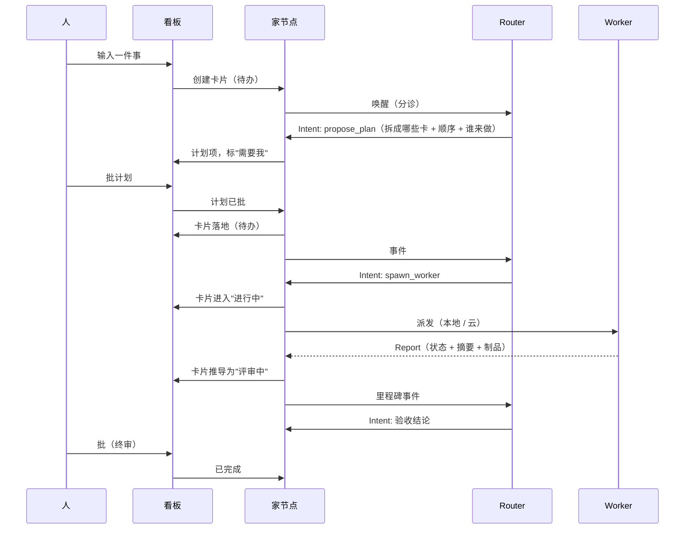

# Tina：产品最终形态

> 状态：**v3 · 2026-11-05** · 定稿
> 本文档回答三个问题：产品故事、架构设计、技术选型。
> 决策与变更记录见 [决策记录](../.agents/notes/archived/design-log.md)。

---

# 第一部分 · 产品故事

## 1.1 一句话

**Tina 是一个以任务看板为中心的项目空间。**

人、智能体、事件在同一个项目里协作。AI 干的活不再是会话，而是项目里可追踪、可验收、可接续的工作。

## 1.2 要解决什么问题

今天的 agent 产品，默认场景是"一个人、一台机器、一个 agent、一次对话"。

这个默认假设漏掉了三件事：

| 症状 | 表现 |
|---|---|
| **工作被困在会话里** | 关掉窗口，任务就找不到了；下次接着做，得重新交代一遍 |
| **项目管理和执行是两张皮** | 看板里记着"要做什么"，agent 在另一个窗口里"做"，两者不通信；进度靠人手工同步 |
| **多个 agent 各自为战** | 一个人推几条线时多开窗口，靠脑子记哪个任务在哪个窗口里 |

根问题是：**把 AI 融入项目管理。**

这句话容易被理解成两件更简单的事，但都不是我们要做的：

- 不是**给项目管理配一个 AI 助手**（写、查、总结、提醒）。这是功能层，会被现有的项目管理工具吃掉。
- 不是**给 AI 配一个任务列表**。那只是把 agent 的待办搬到另一个窗口里，两张皮还是两张皮。

我们要做的是：**让项目本身成为 AI 工作的容器。**

任务在哪，AI 就在哪；AI 做到哪，项目就记到哪。人不需要在"agent 窗口"和"项目管理工具"之间搬运信息——因为只有一份信息。

## 1.3 场景

**谁**：一个人管多个项目的开发者。之后是小团队。
**频率**：一天十几次，不是一天一次。
**核心循环**：

```
想到一件事 → 扔进去 → 去干别的 → 回来验收
```

**一天的样子**

| 时间 | 发生什么 |
|---|---|
| 08:12 | 打开总控台。三件事在等我：两个要批，一个要我选方案 |
| 08:20 | 批掉两个，第三个改了一句需求，打回去 |
| 09:30 | 想到一个 bug。在输入框里写一句话，回车 |
| 09:31 | Router 给出计划：拆成两张卡（修 bug、补回归测试），排好先后，等我在计划上批 |
| 09:35 | 我批了计划，两张卡进入"进行中" |
| 11:00 | 手机上打开看板：修 bug 在"评审中"，测试在"进行中" |
| 18:40 | 回来看结论：PR 链接、根因、两处决策理由。点"批" |

**触发来源**：自己想到、PR 上被 @、CI 失败、线上告警、定时复盘。

**不在这里做的事**：写代码补全、跑 CI、管发布流水线。

## 1.4 产品形态

**一个项目空间。** 里面只有三样东西：

| 组成 | 是什么 |
|---|---|
| **任务看板** | 项目里所有工作的唯一入口与唯一真相 |
| **成员** | 人 + 智能体。智能体是成员，不是工具：有名字、有头像、有当前在做什么 |
| **约定与策略** | 约定写"怎么干活"（进仓库，可 diff）；策略写"能干什么"（结构化配置，可审计） |

智能体分两种角色，都出现在成员列表里：

- **Router（项目经理）**：常驻在项目里。负责拆解、排期、派活、跟进、验收、汇报。
- **Worker（工程师）**：挂在具体任务上。动手、产出、交付、退场。

**它不是什么**：不是聊天软件，不是 IDE，不是又一个 Jira，也不是一个更聪明的终端。

**和相邻产品的关系**

| | 它们擅长 | Tina 的差别 |
|---|---|---|
| 单机 agent harness（pi、Claude Code、DeepSeek Harness） | 一个人、一台机器上的一次工作会话 | 把它们当作**可替换的引擎**，在其上做项目与协作 |
| 云端异步 agent（Devin 类） | 一个云端沙箱里跑一个长任务 | 我们做**多任务 + 多智能体 + 本地云同构** |
| 项目管理工具（Jira / Linear） | 记录和管理**人**做的工作 | 这里的任务**由智能体执行**，状态自动流转 |
| 通用 IM / 协作工具 | 人和人的沟通 | 智能体是**一等成员**，不是被 @ 的机器人 |

## 1.5 交互：以任务看板为中心

这是本产品最重要的一条决定。它决定了产品长什么样，也决定了哪些东西我们不做。

### 1.5.1 两个界面

**首页 · 跨项目总控台**

回答一个问题：**现在需要我做什么？**

| 区块 | 内容 |
|---|---|
| **需要我的** | **凡"下一步只能由人做"的事**：分配给我的待办、计划审批、验收、二选一、冲突裁决 |
| **正在跑的** | 谁在做、做了多久、卡在哪 |
| **项目列表** | 每个项目一行：进度、卡住的数量、最近活动 |

> 第一块不限于"审批"。它是一张**人的工作队列**：agent 做不了的事（打电话确认、去机房插根网线、判断一个需求要不要接）也在这里。
> 判断标准只有一句——**下一步动作只能由人来做。**

**项目页 · 看板**

四列：`待办` / `进行中` / `评审中` / `已完成`。

- 列表示**生命周期状态**。
- 任务之间可以有依赖，卡上标出"被谁挡着"。
- 一个任务可以有多个执行者（v1 只实现单个）。

### 1.5.2 任务卡

卡片正面只有四件事：**标题 · 负责人 · 状态时长 · 产出物。**

**负责人可以是人，也可以是智能体。** 人负责的卡片，状态由人推进（只有他知道做完没有）；智能体负责的，状态由执行推导。

右上角一个标记：**需要我**。它横跨所有列——因为"等我拍板"不是一种状态，是一种注意。

点开是任务视图：对话、执行记录（每次尝试一份报告）、制品、审批历史。

### 1.5.3 四个动作

整个产品的交互原语只有四个。

| 动作 | 含义 | 用在哪 |
|---|---|---|
| **看** | 状态与产出 | 卡片、报告、制品 |
| **问** | 追问或补充要求 | 任务对话 |
| **批** | 审批 / 验收 / 二选一 | "需要我"的卡片 |
| **接** | 接管执行：人接手同一个工作区，智能体在旁边看着 | 进行中的任务 |

**"批"是最重要的一个。** 产品的大部分价值，是把"需要人判断的事"收敛到这一个动作上——不需要人盯过程，只需要处理卡在自己这里的东西。

### 1.5.4 从一句话到一张卡

输入框永远在。输入一句话，默认创建任务。之后分三种情况：

| 你输入的是 | 系统怎么处理 |
|---|---|
| 一件明确的小事 | 直接一张卡，进"待办" |
| 一个目标 | Router 给出计划（拆成哪些卡、顺序、谁来做），出现在"需要我"里等你批；批准后卡片才落地 |
| 只是一句话 | 先以**草稿卡**落在"待办"，不惊动 Router |

**计划要不要人批，由策略决定。** 默认要批；在授权范围内（比如"评审类任务直接执行"）可以跳过。故事 A 就是授权跳过的情形。

**注意最后一行**：聊天不是首页。会话是任务内部的一个面板，不是产品入口。当一句话还不构成任务时，它先变成一张草稿卡——因为账号、项目、任务才是产品里的一等对象。

### 1.5.5 移动端

**移动端有看板。** 四列都在，卡片能看、能问、能批。

另外两个必备能力：处理"需要我的"、对一张卡追问一句。

不做：接管（需要完整工作台）、编辑代码、本地智能体。

### 1.5.6 为什么是看板

三个理由，按重要性排：

1. **看板是"谁在做什么"的唯一真相。** 有它，才不需要靠脑子记任务在哪个窗口。
2. **卡片是收敛复杂度的单位。** 一个任务一个上下文，人不会被十几个并行会话淹没。
3. **列是状态，标记是注意。** 状态由执行推导，不需要人维护；人只处理"卡在我这里"的。

## 1.6 三个故事

架构如果正确，它应该能同时讲清楚下面三件事。注意三个故事都从**看板**开始，不从对话框开始。

**故事 A · 云 + 云（无人值守）**

周五夜里，PR 上被打了一个 `tina-review` 标签。项目看板自动多出一张卡片。这个项目的策略允许评审类任务跳过计划审批，于是 Router 直接派了两个 worker：一个逐行读 diff，一个在干净沙箱里跑测试和扫描——它按项目约定判断这是安全敏感改动。周六早上，卡片出现在"评审中"，附一条结论和两份可展开的证据。人只看那三行，点"批"。

**故事 B · 云 + 本地（数据不出内网）**

一个支付团队不允许源码离开内网。这个项目的家在他们自己的服务器上。看板上有一张"调研 Stripe 新 webhook 重试策略"的卡片——它只需要公开文档，于是执行者被放到云端，产物是一份带引用的笔记回传进卡片。全程没有一行私有代码离开内网。

**故事 C · 人 + 人 + 多智能体（冲突与接管）**

线上告警，看板上瞬间多了三张卡片。两个工程师同时进同一个项目：A 说"先回滚"，B 说"先看日志"。Router 不选边：它开了一张"决策"卡，标上"需要我"，写清两条路的代价，请人拍板；同时把两件不冲突的准备工作并行派了出去。B 顺手对一张卡片点了"接"，在那个工作区里手动跑了三条命令，智能体在旁边看着，之后接着他的状态继续。

## 1.7 目标与非目标

### 目标

- 一个人管多个项目时，**一个总控台看全部**，不需要靠脑子记任务在哪。
- 一个 PR 或 issue 事件，可以**无人值守**地走完：创建卡片 → 执行 → 自审 → 等人验收。
- 同一个项目里，本地机器和云端执行者**同时在场**，人看到的是一条连续的历史。
- 换掉底层 agent 引擎，**产品不受影响**：人、任务、权限、历史全部保留。

### 非目标

- 不做模型训练/推理服务，不绑定任何一家模型。
- 不做通用工作流编排（不是低代码、不是 BPMN）。
- 不做通用 IM、不做 IDE、不做 CI/CD 系统。
- 不做手机端的本地智能体运行时。
- 不追求"全自主软件公司"：人定方向和验收，这一点在可预见的未来不变。
- 生活助手场景暂缓。

---

# 第二部分 · 架构设计

## 2.1 概念模型

层级只有三层：**工作区 → 项目 → 任务**。下面这些是要素，不是层级。

| 概念 | 定义 | 归属 |
|---|---|---|
| **Workspace 工作区** | 租户边界：成员、项目、策略、密钥、账单 | 控制面 |
| **Project 项目** | 一件持续产出的工作。拥有看板、成员、约定、策略、记忆；**Router 的家** | 控制面登记；日志与 Router 在家节点 |
| **Task 任务** | 看板上的一张卡：目标、负责人、依赖、产物、审批 | 项目家节点 |
| **Run 执行** | 一次具体尝试：一个执行者从被派活到交活的完整过程 | 项目家节点 |
| **Report 报告** | 一次 Run 的结构化交付 | 项目家节点 |
| **Node 节点** | 一个执行位置：本地机器或云沙箱 | 节点 |
| **Router 项目经理** | 项目的调度者：拆解、排期、派活、跟进、验收、汇报 | 项目家节点 |
| **Worker 工程师** | 任务的执行者：完整工具面、沙箱、可弃 | 任意节点 |
| **项目约定**（`PROJECT.md`） | 人写给 agent 的长期说明：目标、验收标准、禁区 | 项目内容里，可版本化 |
| **策略 Policy** | 结构化规则：自主度、审批人、预算、数据边界 | 工作区默认在控制面；项目覆盖随项目 |
| **Event 事件** | 一切输入：人说话、PR、CI、报告、定时、mention | 项目家节点 |
| **Artifact 制品** | PR、补丁、文档、报告、截图、测试结果 | 项目家节点（本地目录 / 对象存储） |
| **Approval 审批** | 需要人或策略批准的动作 | 项目家节点 + 控制面通知 |
| **Intent 意图** | Router 产出的结构化动作请求 | 运行时执行 |

### 三层数据：Task / Run / Report

这是整个"执行 → 记录"链条的骨架。

```
Task（卡片，持久）
 │
 ├─ Run #1 ──── Report #1
 ├─ Run #2 ──── Report #2
 └─ Run #N ──── Report #N
 │
 └─ 结论（Router 合成，人看这个）
```

- **Task 比任何一次执行活得久。** 它可能被重试、被换人做、被打回重做。
- **Run 是一次尝试。** 每个 Run 有自己的耗时、用量、结果。
- **Report 挂在这个 Run 上。** 如果报告挂在 Task 上，第二次执行就会冲掉第一次——而"第一次为什么失败"恰恰是复盘时最有价值的信息。

由此得到两条规则：

1. **报告必须挂在执行上**，不挂在任务上。`Task 1:N Run`、`Run 1:1 Report`。
2. **卡片状态是推导出来的**：由 Run 的执行事实推出，不需要人维护，也不需要 agent 手动去改。（人负责的卡片没有执行者，由人自己推进——见 1.5.2。）

报告必须**有兜底**：执行者崩了、超时了、忘了交，运行时从转录里自动生成一份，标记为"自动生成"。否则卡片会永远卡在"进行中"，而卡住的任务正是最需要人看的东西。



## 2.2 两级智能体

### 为什么分两层

一个 agent 同时做"想清楚做什么"和"埋头做完"，会陷入长上下文、长任务、难恢复的状态。分开之后：

- **Router 便宜且稳定**：输入是摘要，输出是意图，失败可重试，上下文不会爆炸。
- **Worker 深且可弃**：能读一万行代码，能在沙箱里炸掉，能换一个重跑。
- **出问题时能立刻判断**：是决策错了，还是执行错了。

### Router：项目经理

**做**：理解意图、拆任务、排优先级、制定计划、选执行者与放置、跟进、验收、决定何时问人、汇报。

**不做**：不读大量源码、不执行命令、不直接改文件。

**关键：Router 的能力按副作用分级，而不是按"工具数量"限制。**

| 等级 | 例子 | 形态 | 理由 |
|---|---|---|---|
| **只读** | 看板、任务历史、项目约定、记忆检索 | 工具 | 无副作用，越方便越好 |
| **低风险副作用** | 发消息、建卡、改状态 | 工具，但过策略 | 可撤销、影响面小 |
| **高风险副作用** | 改文件、跑命令、开 PR、调外部 API | **只能是意图** | 由运行时执行，策略、预算、审计都在这条路上 |

核心原则：**手里的工具不能"改世界"，只能"表达"。** 智能体的自由体现在"想"，不体现在"手"。

**意图集是开放的**——否则每加一个能力都要改产品代码。但执行管道必须统一：**所有意图走同一条「校验 → 执行 → 审计」的路**。否则迟早出现"某个意图忘了检查预算"。

| 常见的意图 | 作用 |
|---|---|
| `propose_plan` | 提出计划：拆成哪些任务、顺序、优先级、谁来做 |
| `spawn_worker` | 派生执行者：任务、预设、放置、预算、验收标准 |
| `message` | 对项目、人、任务或执行者发言 |
| `ask_human` | 阻塞式提问或审批请求 |
| `update_task` | 状态、依赖、切分、优先级 |
| `cancel` | 停止某个执行 |
| `schedule` | 在未来某个时间点唤醒自己 |
| `finish` | 宣告目标达成或明确失败 |

### 什么事件才唤醒 Router

Router 挂在项目上，必须防止被日常琐事淹没。

| 事件类型 | 例子 | 唤醒？ |
|---|---|---|
| **记录型** | 任务进度、工具调用、日常输出、文件变更 | ❌ 只更新卡片与日志 |
| **决策型** | 需要拆任务、任务间冲突或依赖、失败重试、越权、超预算 | ✅ |
| **里程碑** | 任务完成、等待验收 | ✅ |
| **人声** | 任何人在项目或任务里发言 | ✅（合并窗口内去抖） |
| **外部** | PR、CI、告警、webhook、定时 | ✅（按对象去重） |

两条护栏：每个项目每小时的唤醒次数有上限，超限则合并或转人工；被拒绝的事件不丢弃，进收件箱等下一次唤醒一起看。

### Worker：工程师

- 任务级生命周期，一个执行者一个引擎进程（可弃、可重建）。
- 完整工具面：读写文件、shell、测试、语言服务、浏览器、搜索。
- 跑在沙箱里，工作区来自项目绑定（克隆 / worktree / 卷）。
- 可选自审：交给人之前，派一个独立执行者做对抗性评审。

**必须交结构化报告**：

| 字段 | 内容 | 谁用 |
|---|---|---|
| 状态 | 完成 / 失败 / 阻塞 / 部分完成 | Router 决定下一步 |
| 摘要 | ≤ 一屏：做了什么、结论是什么 | Router、人 |
| 决策 | 关键取舍和理由 | 人复盘、审计 |
| 制品 | PR、补丁、报告、测试结果、引用 | 人验收 |
| 阻塞 | 需要谁回答什么问题 | Router 转成提问 |
| 用量 | token / 成本 / 耗时 / 工具调用次数 | 预算、成本 |

> 这份 schema 是整套架构里最容易被低估的东西：Router 不读执行者的完整转录（太贵、太长、噪声太大），只读报告。**它就是"协作的 API"。**

### 自主度

| 等级 | 含义 | 默认场景 |
|---|---|---|
| **L0** | 只读、只建议，所有动作需人执行 | 新人、敏感仓库 |
| **L1** | 沙箱内自由行动，不产生外部副作用 | 日常开发 |
| **L2** | 有外部副作用需人批准（开 PR、推送、发消息） | **默认** |
| **L3** | 全自主（合并、部署、对外沟通） | 明确授权的流水线 |

自主度不是提示词，而是**运行时强制**：意图在执行前被策略引擎判定，越界直接拒绝并升级。

## 2.3 协作模型

**参与者**：人、Router（每项目一个）、Worker（每任务一个或多个）、外部系统。

**三条规则**：

| 规则 | 内容 |
|---|---|
| **发言权** | 人随时可说话；Worker 默认只通过报告发声；打断优先级 人 > Router > Worker |
| **冲突** | 两个人同时下指令时，Router 不选边，而是开一张决策卡，标"需要我"，写清代价，请人拍板 |
| **接管** | 人可以从执行者手里接过同一工作区，手动操作；智能体旁观，之后接着人的状态继续 |

**接管**是"人机协作"最真实的样子：不是人给 agent 派活然后等待，而是**两个执行者轮流用同一块工作台**。

**审批**是看板上的对象，不是聊天里的一句"可以吗"。谁有权批、需要几个人、超时怎么办，由策略决定。无人应答时按策略升级。

| | 人 + 人 | 人 + 智能体 | 智能体 + 智能体 |
|---|---|---|---|
| **共享什么** | 看板、任务对话、在场状态 | 对话、审批、**同一工作区** | 看板、结构化报告、消息 |
| **难点** | 多人同时写而不打架 | 人从智能体手里接管 | 跨机器、跨项目的通信与身份 |
| **答案** | 单一写者 + 事件合并 | 同一沙箱 + 暂停在安全点 | 星形经 Router 中转 |

## 2.4 系统分层

```text
客户端        Web (React) · Desktop (Electron) · Mobile · TUI
                    │  HTTPS / WSS
                    ▼
控制面 (Go)  ← 唯一入口
              身份 · 目录 · 连接与中继 · 摘要索引 · 事件入口 · 推送 · 审计
              ⚠ 不跑 agent、不存项目日志、不决定派活、不执行策略
                    │  认证后的转发（哑管道）
                    ▼
节点运行时    Node + Effect —— 本地 / 云，同一份代码
              项目日志（单写者）· 家 · 事件收件箱 · 调度 · 策略执行
                    │  引擎端口（进程边界）
                    ▼
引擎          DeepSeek Harness（现在）/ 自研（未来）
              Router 会话 · Worker 会话
                    │
                    ▼
执行世界      本地 fs / shell / GPU     或     云沙箱容器
```

### 控制面的职责

**边界规则只有一句：控制面只做"单机做不到"的事。**

| 组 | 负责什么 |
|---|---|
| **身份与访问** | 账号、组织、成员、角色；节点配对与证书签发/吊销 |
| **目录与发现** | 项目 → 家节点 的映射；节点清单与能力声明 |
| **连接** | 客户端到家的路由；节点之间的流；NAT 穿透与中继 |
| **聚合与治理** | 摘要索引（喂总控台）、审计汇聚、配额与计费 |
| **入口与出口** | Webhook 入口（GitHub / CI / 告警）、移动推送、邮件与 IM 通知 |

**它明确不做的四件事**：

| 不做 | 为什么 |
|---|---|
| 不跑 agent | 控制面里没有引擎，Go 侧一行 agent 逻辑都没有 |
| 不存项目日志 | 日志的权威在家节点；云上最多存只读副本 |
| 不决定任务派给谁 | 放置决策在家；控制面只提供"有哪些节点、各自能干什么"的候选清单 |
| 不执行策略 | 策略由节点运行时执行；控制面只负责分发与统一视图 |

第三条最值得强调：**控制面提供的是候选清单，不是调度决定。** 一旦让它决定派活，agent 语义就漏进 Go 里了。

一个判断两者是否被混淆的思想实验：

> **控制面挂了**：你连不上，但项目还在跑，Router 还在派活。
> **Router 挂了**：项目停摆，但你依然能连上、能看历史。
> 两个故障互不传染。

### 节点运行时

节点是真正的干活的地方，负责：

- 写项目日志（它是"家"）
- 跑 Router 会话、派生 Worker 会话
- 维护事件收件箱与分诊
- 执行策略、管预算
- 管理本地工作区与沙箱

同一个节点进程可以托管多个项目的家——项目是**逻辑**隔离单位；真正需要故障隔离的是 Worker，它跑用户代码，所以独立进程。

### 引擎

引擎跑在**进程边界之外**，通过端口协议驱动。理由有三：

1. 引擎崩了不会带走产品状态。
2. 换引擎时改动面被端口挡住。
3. dsh 自己的官方扩展方式就是"profile + bundle"，逆着它设计没有好处。

## 2.5 单一写者与"家"

每个项目在任一时刻有一个**家节点**。

| | 谁能做 |
|---|---|
| **写** | 只有家 |
| **读** | 家在线时由家提供；家离线时，云上保留的只读副本仍可浏览（标注"离线，最后同步于…"），但不能写 |
| **attach** | 任何客户端、任何节点 |

**为什么不做多写**：多写的代价是冲突合并——那会成为永远做不完的工程，而且"谁改了什么"很难审计。看板和自动记账的价值不需要多写。

**家可以迁移**，这是"同一个产品覆盖多种部署"的关键能力：

```
冻结写入 → 快照（日志 + 看板 + Router 状态 + 项目约定）
        → 新家重放并校验 → epoch + 1 → 旧家降级为只读副本
```

迁移期间项目短暂只读（目标秒级），幂等、可恢复。触发方式：

- 用户主动"提升为常驻云端"
- 策略要求（敏感数据必须落本地）
- 本地机器长期离线

## 2.6 部署形态

**连接形状永远是星形**：客户端只认识控制面，节点也只认识控制面。跨节点的流经控制面中继。



变的只是**每个组件部署在哪**：

| 形态 | 控制面 | 家节点 | Worker | 典型场景 |
|---|---|---|---|---|
| **本地单机** | 本机 | 本机 | 本机 | H0 验证 |
| **本地 + 本地** | 局域网主机 | 机器 A | 机器 B | 内网、离线、合规 |
| **云 + 本地** | 云 | 云 | 本地 | 云端统筹，代码在个人机器上 |
| **全云** | 云 | 云 | 云 | 团队 SaaS、无人值守 |

**组件与部署位置无关。** 控制面可以从本机搬到局域网搬到云，节点也是，代码不变。

这就是"云 + 本地"这个卖点在架构上的全部含义——不是两套产品，是同一套组件的不同摆法。**拓扑是配置，不是架构。**

## 2.7 关键流程：一张卡片的一生



外部事件走同一条链，只是入口不同：

```
GitHub / CI / 告警 → 控制面验签去重 → 项目家节点 → 幂等写入日志 → 创建或更新卡片 → 分诊唤醒 Router
```

**状态推导规则**（卡片状态不靠人维护）：

| 卡片状态 | 由什么推出 |
|---|---|
| 待办 | 没有活跃的 Run |
| 进行中 | 有 Run 在跑 |
| 评审中 | 有 Run 交付了报告，等验收 |
| 已完成 | 验收通过 |

> **人负责的卡片例外**：它没有执行者，状态由人自己推进。上表只适用于有执行者的卡片。

## 2.8 引擎端口与可替换性

我们计划自研引擎。如果产品长在某个引擎的内部结构上，那天就等于重写产品。

**端口**（小到能维护，大到够用）：

```
create/resume session(spec) -> sessionId
send(sessionId, input)      -> receipt
interrupt(sessionId)
respond(sessionId, requestId, answer)
subscribe(cursor)           -> stream<EngineEvent>
fork(sessionId, at)
close(sessionId)
capabilities()              -> 模型、工具、压缩、审批能力
```

`EngineEvent` 是**规范化**的产品级事件：消息、工具调用、工具结果、审批请求、提问、状态、用量、回合边界。**不把任何引擎的原生类型泄漏到产品侧。**

**双日志**：

| 日志 | 属于谁 | 用途 |
|---|---|---|
| **产品日志**（权威） | Tina | 项目与任务事件、审批、意图、报告。格式由我们定 |
| **引擎日志**（内部） | 引擎 | 每个会话的原生转录。可以有自己的格式和迁移路径 |

产品日志必须**足以重建上下文**——否则换引擎时，历史就变成不可读的化石。

**判断标准**：如果换掉引擎后它还有意义，它就必须在产品侧。

- ✅ 产品侧：项目与任务、事件、审批与自主度、身份与权限、放置与预算、记忆与约定、审计
- ❌ 引擎侧：提示词组装、工具循环、上下文压缩、模型路由、沙箱内执行细节

---

# 第三部分 · 技术选型

## 3.1 选型总表

标注：**已定** = 不讨论，除非有强理由；**倾向** = 默认如此，允许推翻。
"H0 需要"指第一阶段（本地单机验证版）是否必须。

| 层 | 选择 | 状态 | H0 | 理由 |
|---|---|---|---|---|
| 节点运行时 | Node 22+ / TypeScript / **Effect** | 已定 | ✅ | 长生命周期、并发、取消、资源释放、流、Schema |
| Agent 引擎 | **DeepSeek Harness**，进程边界外 | 已定 | ✅ | 省掉大量 harness 工作 |
| 引擎接入 | **自写 bridge 插件**，不走上游 SDK 协议 | 已定 | ✅ | 见 3.3 |
| 项目日志 | **SQLite**（WAL，append-only 表）+ 本地文件系统 | 已定 | ✅ | 单文件、事务、可查询、可导出 |
| 控制面 | **Go**（标准库优先，Connect 做 RPC） | 已定 | ✅ | 单二进制、WS 扇出、成熟鉴权 |
| 控制面存储 | **SQLite**（H0 / 小规模）→ Postgres（规模需要时） | 倾向 | ✅ | 见 3.3 的说明 |
| 对象存储 | 本地目录（H0）→ S3 兼容（云） | 倾向 | ✅ | 只存大块，接口很小 |
| 控制面协议 | **protobuf + Connect**（buf 生成 TS/Go） | 倾向 | ✅ | 避免两套手写契约 |
| 引擎端口传输 | 本地 socket 上的 JSON-RPC | 已定 | ✅ | 与引擎自身的 stdio 限制解耦 |
| 实时通道 | WebSocket，经控制面 | 已定 | ✅ | 星形连接 |
| Web 前端 | **React + Vite + TypeScript**，自研外壳 | 已定 | ✅ | 界面中心是看板，不是会话转录 |
| 桌面 | Electron | 已定 | ❌ | 桌面 = Web + 本地节点 |
| 移动端 | **PWA 优先**（复用 Web），原生后置 | 倾向 | ❌ | 移动端有看板后，复用价值大于原生体验 |
| 可观测性 | OpenTelemetry | 倾向 | ⚠️ | 一次追踪：人 → Router → Worker → 工具 |
| 事件总线 | 控制面自身的存储 + 长连接；不引入消息中间件 | 倾向 | ❌ | 别在第一天过度设计 |

## 3.2 H0 的最小技术栈

四个组件，一条命令起来：

```
tina up
├─ 控制面      Go 单二进制        localhost:7801
├─ 节点运行时   Node + Effect     注册到控制面
├─ 引擎        dsh 子进程池       profile: tina-node
└─ Web UI      控制面托管          打开 http://localhost:7801
```

| 组件 | 语言 | 职责 | 复用 |
|---|---|---|---|
| 控制面 | Go | 账号、节点、目录、WS 入口、转发、摘要索引 | — |
| 节点运行时 | TS + Effect | 家、日志、收件箱、调度、策略、引擎适配 | — |
| bridge 插件 | TS | 把 dsh 的会话能力暴露成端口协议 | dsh 的 Cordis 插件机制 |
| Web UI | React | 看板、任务、审批 | — |

**H0 不做的**：多租户、组织与角色、SSO、多节点放置、NAT 穿透、对象存储、Postgres、移动端、桌面打包。

## 3.3 五个关键取舍

每条都给代价——只讲好处的选型文档没有用。

### ① 为什么节点运行时用 Effect

**理由**：节点运行时是常驻进程，管着一堆长期存在的资源（引擎子进程、日志句柄、事件流、定时器、沙箱），Effect 的 `Scope`、`Fiber`、`Queue`、`Stream`、`Schema` 正好对得上这些需求。尤其是**取消**——"停掉一个正在跑的任务"必须能穿透到子进程和网络流，手写这个很容易漏。

**代价**：学习曲线陡；fiber 的堆栈比 async/await 难读；团队必须统一写法，否则会出现"一半 Effect 一半 Promise"的混合体。

**边界**：Effect **只在节点运行时里用**。Web UI 保持朴素（React + 普通 hooks），Go 控制面自然不用。

### ② 为什么不走 DeepSeek Harness 的官方 SDK

**理由**：官方 SDK 的协议很薄——**没有 cancel、没有 fork、没有 session 列表，而且只监听 stdio**。一个产品不可能靠"杀进程"来表示"停止"。同时它的扩展方式是"profile + bundle + 插件"，写一个自己的 bridge 插件是它支持的路径，不是绕过。

**代价**：要跟着 dsh 的版本走。它现在是 developer preview，会破坏兼容；bridge 是一个需要持续维护的适配层。

**缓解**：端口本身就是防波堤——dsh 的变化只影响 `engine-dsh` 一个包，不影响产品。

### ③ 为什么控制面是 Go 而不是 TS

**理由**：一个静态二进制，扔到任何机器上就能跑；WebSocket 扇出和连接管理是 Go 的舒适区；鉴权、OIDC、证书这些有成熟库。更重要的是**语言边界本身就是防腐层**——Go 写不出 agent 逻辑，因为它没有引擎。

**代价**：两门语言、两套工具链、两份 CI。团队要能同时维护。

**缓解**：控制面的职责被压得很薄（2.4 节那五组），薄到一个人能在几天内读完。

### ④ 为什么存储分两套

**理由**：节点永远用 SQLite + 文件系统（本地和云节点完全一致，云节点就是挂一块持久卷）；控制面用 SQLite 起步、规模需要时迁 Postgres。这不是"同一套代码可切换后端"，而是**两个所有者各自演进**。

**代价**：不能一套代码两处跑；摘要索引在两个地方各有一份写入逻辑。

**为什么不是一上来就 Postgres**：H0 要"一条命令跑起来"。为了一个本地单用户安装去要求用户先装数据库，代价太高。而控制面的数据量（一个账号、几个节点、一个目录、几百条摘要）SQLite 绰绰有余。

这不是提前造抽象层——**将来真需要时做一次性迁移**，现在不付这笔钱。这也是 3.4 里"不做可切换后端"的同一条原则。

### ⑤ 为什么前端自研外壳

**理由**：产品界面中心是看板、任务、"需要我"，不是单会话转录。把 dsh 的 Web 客户端插件体系嵌进来，会得到一堆很漂亮但我们不需要的会话界面，并被它的构建与协议绑住。

**代价**：转录渲染、工具调用卡片、审批组件、diff 视图这些，都要从头做。这是本方案里最大的一块"重复劳动"。

**缓解**：先把"最小可用渲染"做出来（文本 + 工具名 + 结果折叠），漂亮的事后置。

## 3.4 明确不选

| 不选 | 原因 |
|---|---|
| 在 Go 里写 agent 逻辑 | 会分裂领域模型，两套语义互相污染 |
| 使用 dsh 官方 SDK 协议 | 缺 cancel / fork / list，且只走 stdio |
| 在浏览器里跑 Effect | 收益不抵成本，UI 侧保持朴素 |
| 自研消息队列 | 先借现成的，规模到了再说 |
| 把项目日志放 NFS / 共享盘 | 文件锁不可靠，单一写者会失效 |
| "一套存储可切换后端"的抽象 | 造出来两边都不好用，见 3.3 ④ |

## 3.5 待验证

| 待验证 | 影响什么 | 怎么验 |
|---|---|---|
| bridge 插件能否做到 cancel / fork / list | Worker 的可控性；做不到就要改端口设计 | H0 第一周做 spike |
| SQLite 在多人 attach + 高频事件下的写性能 | 单一写者的容量上限 | 压测：10 客户端 + 每秒 50 事件 |
| Effect 与子进程/流的集成复杂度 | 节点运行时的工期 | spike：跑通"启动引擎 → 流事件 → 取消" |
| WS 中继的延迟 | "接管"是不是可用的体验 | 局域网 + 公网各测一次 |
| Electron 的打包体积与启动时间 | 桌面产品的第一印象 | 打包测 |

## 3.6 代码组织

```
tina/
├─ apps/
│  ├─ web/             React 前端（Web + 桌面共用）
│  ├─ desktop/         Electron 外壳
│  └─ cli/             tina 命令（up / attach）
├─ services/
│  └─ control-plane/   Go 控制面
├─ packages/
│  ├─ node-runtime/    节点运行时（Effect）
│  ├─ engine-port/     端口协议定义
│  ├─ engine-dsh/      dsh bridge 插件 + 适配
│  ├─ protocol/        protobuf（buf 生成 TS/Go）
│  └─ ui-kit/          组件库
└─ docs/
```

**移动端**在独立仓库（按最初约定），复用 `packages/protocol` 与设计系统。

---

# 附录 · 决策索引

> 完整过程（含推翻记录与判断集）见 [决策记录](../.agents/notes/archived/design-log.md)。这里只列结论。

| 主题 | 决策 |
|---|---|
| **产品定位** | D1 首发场景是软件工程团队 · D5 团队 SaaS 优先 · D9 生活助手暂缓 · D10 第一用户是一人管多项目的开发者，市场是小团队与个人 · D11 根问题是"把 AI 融入项目管理" |
| **交互** | D12 以任务看板为中心，原语只有 看 / 问 / 批 / 接 · D13 首页是跨项目总控台，项目页是看板 · D15 四列：待办 / 进行中 / 评审中 / 已完成 · D36 计划默认要人批，策略可跳过 · D37 移动端有看板 · D38 "需要我的"＝下一步只能由人做的事 · D39 看板不区分人做的和智能体做的 |
| **概念与数据** | D6 三层：工作区 → 项目 → 任务，Router 挂项目 · D8 章程拆为项目约定 + 策略 · D19 任务平铺，用依赖表达先后 · D20 任务 1:N 执行者（v1 单执行者）· D21 完成判定：报告 → 评审中 → Router 首审 → 人终审 · D22 报告挂 Run（`Task 1:N Run`、`Run 1:1 Report`）· D23 卡片状态由执行推导 |
| **智能体** | D14 最终形态含计划能力 · D17 Router 受限：不持有"能改世界"的工具，意图集开放 |
| **运行与部署** | D2 云算力由我们托管沙箱 · D16 单一写者 · D18 引擎在进程边界外 · D24 云上只存摘要索引 · D25 控制面不理解 agent 运行协议 · D26 节点单进程托管多项目，Worker 独立进程 · D27 实时走控制面 WS，日志本地 SQLite · D28 本地验证版是一等形态 · D29 两个所有者两种存储 · D30 已由 D33 取代 · D31 控制面边界＝单机做不到的事 · D32 策略分两层 · D33 控制面是唯一入口 · D34 组件与部署位置无关 · D35 H0 控制面收窄到三件事 |
| **技术** | D3 Go 只做控制面 + 中继 · D4 自研前端外壳 |
