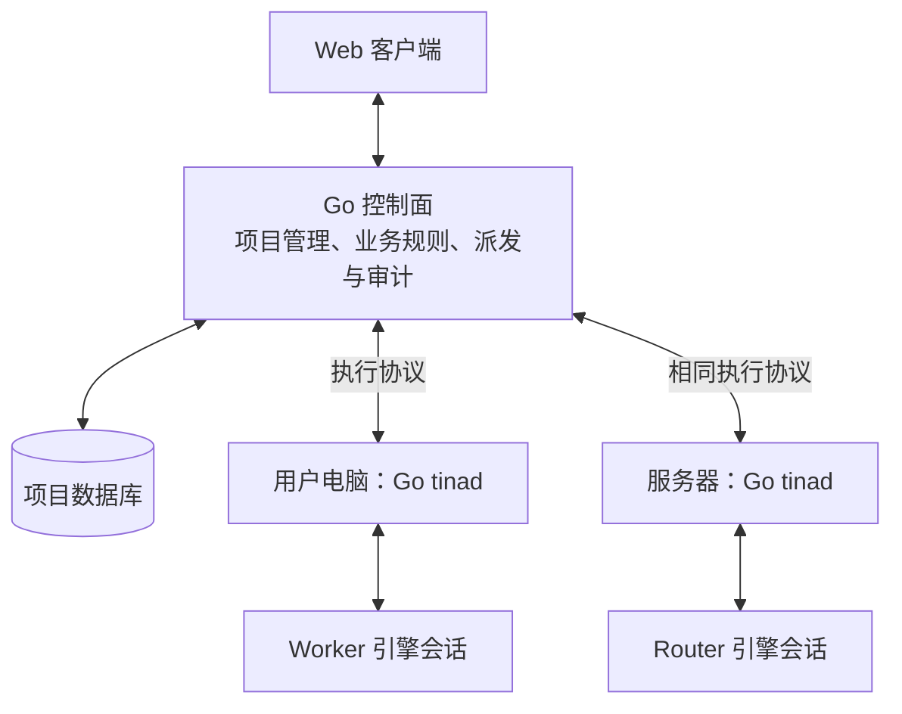

# Tina 架构

本文是架构阅读入口，说明系统的总体结构、组件边界和文档分工。修改控制面、tinad、执行协议或引擎适配前，先阅读本文，再按涉及的主题进入下级文档。

## 总体结构

**控制面维护项目，tinad 承载 Agent 执行。** 控制面执行确定性的项目规则；模型推理与工具调用由 tinad 后面的引擎完成。

Router 和 Worker 使用同一套执行机制，图中的位置只是部署示例。两种角色都可以运行在本机或服务器；控制面和 tinad 可以分别部署。

项目数据的归属独立于 Agent 的执行位置。移动 Agent 只改变执行绑定，不迁移项目库；执行机器离线也不使项目和历史记录消失。

## 组件边界与深入阅读

下级文档分别维护组件机制、线协议和适配语义。本文保留跨组件边界，具体规则在对应文档中维护。

| 文档 | 负责说明 | 何时继续阅读 |
|---|---|---|
| [控制面项目服务](control-plane.md) | 项目权威数据、业务规则、事务、任务状态与 HTTP API | 修改项目、任务、计划、审批、报告、派发决策或数据存储 |
| [tinad 执行服务](tinad.md) | 执行服务内部结构、本机授权、会话管理、持久回传与进程监管 | 修改节点连接、执行资源、引擎部署或本机权限 |
| [执行协议](execution-protocol.md) | 控制面与 tinad 的消息、身份关联、投递、取消、终态、去重与对账 | 修改跨机器通信、取消或恢复规则，分析任务流与断连行为 |
| [引擎适配契约](engine-adapter-contract.md) | 工厂与会话的复用、原生句柄、能力声明和操作语义 | 接入引擎，或修改创建、恢复、输入、中断与资源释放 |

控制面与 tinad 通过执行协议交换命令和事实；tinad 与适配器通过本机 Go 接口协作。两种边界各自独立，引擎原生协议由适配器解释。

控制面校验项目业务授权，tinad 校验机器所有者授予的本机执行权限。Router 的建议需要经过控制面的业务规则，不能代替任一层授权。

## 其他阅读入口

产品场景、长期形态与技术取舍见 [产品愿景](vision.md)。本地启动、配置与数据导入操作见 [使用说明](../README.md)。
