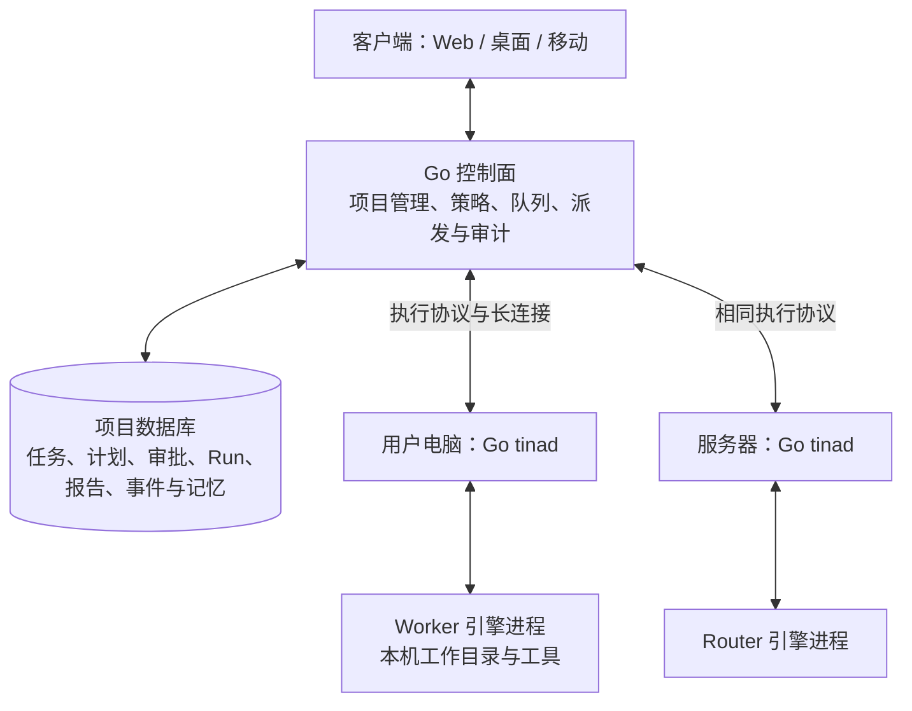
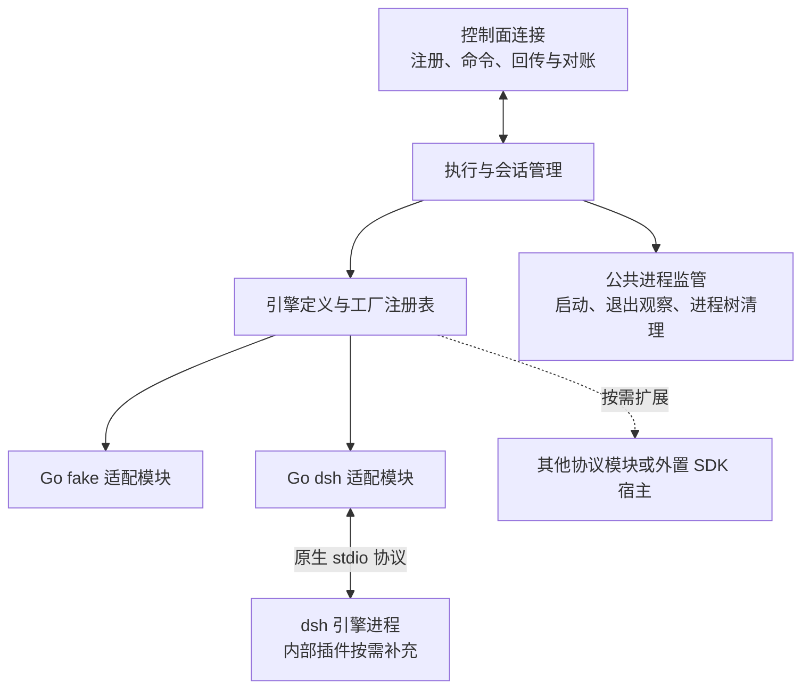
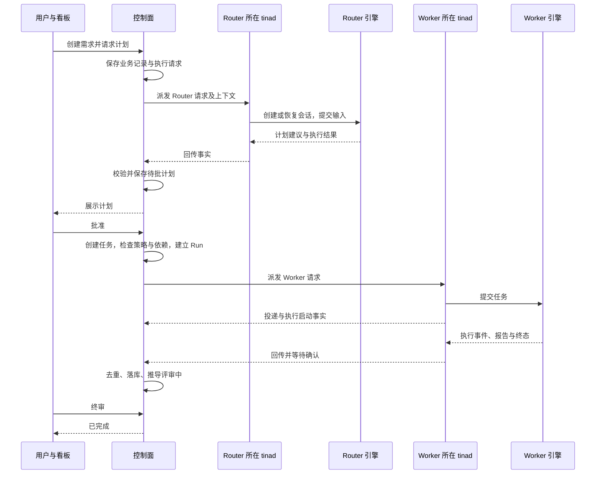

# Tina 架构

> 修订 5 · 2026-11-09 · P1–P5 已接通 Go 控制面、tinad、取消与异常对账
> 项目数据不再由 TS 节点托管；一条命令启动和迁移验收在 P6 收尾。
> 修改控制面、tinad、共享协议或引擎接入前读取本文。实施阶段见 [下一步实施修改计划](next-implementation-plan.md)，适配操作语义见 [引擎适配契约](engine-adapter-contract.md)，产品目标见 [vision.md](vision.md)。

## 1. 总体结构

**控制面维护项目，tinad 承载 Agent 执行。** 项目的可访问性与执行机器是否在线分开；Router 和 Worker 都通过 tinad 接入，控制面不运行引擎。

图中的角色位置只是一个部署例子。Router 可以运行在本机，Worker 也可以运行在团队服务器；控制面与服务器 tinad 可以分开部署。用户只有调用本机 Agent 时才需要安装 tinad。控制面和项目库可以在本机、内网或云端自托管。

“家节点”不再属于目标模型。移动 Agent 的执行位置不迁移项目库，也不产生第二份可独立写入的项目状态。

## 2. 职责与数据归属

| 层 | 职责 | 数据 |
|---|---|---|
| 客户端 | 展示看板、计划和报告，提交人工输入、审批与取消 | 视图缓存、用户草稿与界面偏好 |
| 控制面 | 项目 API、权限与策略、校验 Router 建议、依赖检查、排队派发、状态推导、结果去重和审计 | 项目业务数据的权威记录 |
| tinad | 机器与 Agent 注册、连接与重连、本机授权与容量检查、会话管理、执行回传、取消与进程监管 | 执行关联、待回传记录、工作目录与本机配置 |
| 引擎适配器 | 转换调用、原生事件、交互请求、结果和停止证据 | 会话实例的运行状态与原生句柄 |
| 引擎 | 模型推理、工具循环、内部上下文与原生转录 | 引擎自己的会话日志与持久历史 |

控制面保存项目、成员、Agent 身份与配置、任务、计划、审批、Run、报告、产品事件和 Router 显式记忆。业务变更及其产品事件在同一事务中提交。

制品的元数据、归属和可访问性由控制面维护；文件可以留在执行机器，也可以按策略上传。项目数据集中维护不要求把源码、凭据和全部原生转录上传到服务器。

控制面运行确定性的业务规则。Router 承担语义判断与建议，实际推理由 tinad 后面的引擎完成；建议回到控制面后经过统一的校验、审批、执行或派发与审计路径。

## 3. tinad 内部结构

控制面、tinad 和普通适配器使用 Go。Web 与现有 CLI 保持 TypeScript。需要访问 dsh 内部能力时按其扩展机制编写 TS 插件，特殊 SDK 接入可以按需增加薄的外置宿主；tinad 不引入 Effect。

普通适配器是内部模块，直接调用统一 Go 接口，不强制经自定义 TCP 再绕一层适配进程。引擎进程仍与 tinad 隔离；适配器自身是否外置由实际运行时或扩展需求决定。

适配按引擎接口或协议族复用。一个工厂可以为多个 Router、Worker 创建会话，实例之间独立维护原生句柄、活动、事件订阅和交互请求。同协议引擎优先复用生命周期与传输，差异由启动配置和薄的适配处理。

公共进程监管负责 tinad 持有的进程及其工作负载；适配器负责引擎特有的中断协议与资源释放。发出终止信号不等于已经观察到退出。

## 4. 身份与生命周期

| 对象 | 含义 |
|---|---|
| Agent | 项目成员身份、角色、配置、可用范围及 tinad 绑定；注册不要求进程常驻 |
| Task | 持续追踪的工作，可经历多次尝试 |
| Run | 一次业务尝试，记录发起人、Agent、执行位置及终态 |
| 命令 | 一次派发、输入或取消操作，使用稳定命令 ID 处理重复投递 |
| 会话 | 可持续交互的上下文，关联引擎返回的原生持久句柄 |
| 活动 | 会话中的当前输入或回合，关联事件、结果和取消目标 |
| 执行实例 | 某次进程或连接实例，用于排除旧实例的迟到事件 |

会话 ID 不使用 PID 代替。Run 结束不自动删除会话，释放运行时也不等于删除持久历史。恢复使用原生句柄；引擎拒绝恢复时明确报告，不用新建会话冒充成功续接。

`Task 1:N Run`、`Run 1:1 Report`。卡片状态由控制面的执行事实和审批结果推导；人手动覆盖状态时保留覆盖记录。执行确认失败且缺少有效报告时，控制面根据已收到的事实生成醒目标记的兜底报告。

## 5. 通信与任务流

平台有两种不同的接口：

- **控制面与 tinad 的执行协议**：跨机器传输注册、派发、输入、取消、事件、报告、确认与对账消息。消息携带稳定的业务关联和版本信息。
- **tinad 的 Go 适配接口**：探测引擎、创建与恢复会话、提交输入、订阅事件、中断活动及释放运行时。外置适配实现也遵守这些语义。

前者使用语言无关的序列化契约，不暴露 Go 内存对象或引擎内部类型；后者是本机模块调用，不规定每种引擎采用相同的底层协议。

Router 评审、追问和外部事件使用相同的业务入口与执行路径。tinad 不接收建卡、批准计划、终审等项目管理命令。

## 6. 投递、取消与故障

投递区分传输已接纳但待确认、引擎已接受、明确拒绝和结果未知。命令回执不等于执行启动，执行启动不等于终态；无回执也不能证明输入未被执行。

取消分为业务取消请求、引擎当前活动中断及运行时／工具清理。控制面持久记录请求，tinad 针对活动发出中断并回传停止证据。父进程退出、相关工具工作负载退出和活动终态分别报告。原生取消不可用时，关闭进程是明确记录的降级方式。

只有确认对应活动停止或收到其他有效终态，控制面才结算该 Run；清理或停止结果不明时保留待对账信息，不合成取消完成来启动新执行。已完成的业务结果不被迟到取消或清理错误改写。

| 情况 | 行为 |
|---|---|
| tinad 离线 | 项目和历史仍可访问，已有审批可处理；需要该执行位置的工作排队 |
| Router 不可用 | 人工项目管理仍可用，等待模型判断的工作保持等待 |
| 控制面不可用 | 暂停新派发与业务写入，tinad 按策略处理已启动工作并暂存结果 |
| 重连或重启 | 按命令、Run、事件与执行实例对账并去重；不能因断连自动推断停止或盲目重跑 |

控制面验证业务授权，tinad 检查本机授权与容量。个人机器的管理权与使用权分开；Router 的建议或管理员身份不能替代机器所有者授权。

## 7. 代码落地与实施顺序

| 位置 | 目标 |
|---|---|
| `services/control-plane` | 已迁入项目 API、SQLite 存储、业务规则与持久待执行队列 |
| `services/tinad` | Go 执行服务、适配注册表、会话与进程管理 |
| `packages/protocol` | 控制面与 tinad 共用的 Go 执行消息及语言无关线格式 |
| `apps/web`、`apps/cli` | 保持 TS，分别访问控制面与启动组件 |
| 原 `packages/node-runtime`、`engine-port`、`engine-fake`、`engine-dsh` | H0 行为基线，相关业务和执行职责迁移后切换生产入口 |

先完成 P1 的消息契约、Go 适配接口与离线契约验证，再做 P2 的控制面项目存储和业务迁移，随后按实施计划完成 tinad、闭环、取消对账与切换。P1 建立可复用模块，不提前宣称 H0 已切换为新架构。

P1–P4 已提供共享 Go 协议、控制面项目存储与业务、Go tinad、fake/dsh 内部适配、进程监管、持久回传和自动派发。两个独立 tinad 的任务闭环通过离线验证，控制面重启后保留原尝试并对账。取消与异常处置在 P5 完成，CLI 全栈启动及迁移在 P6 收尾。当前 API 见 [控制面项目服务](control-plane.md)，执行配置见 [tinad](tinad.md)，消息规则见 [执行协议 v1](execution-protocol.md)。

H0 规格和验收结果保持历史内容。`vision.md` 说明产品与架构共识，本文提供工程阅读入口，适配契约定义操作语义，实施计划规定阶段与验收。
