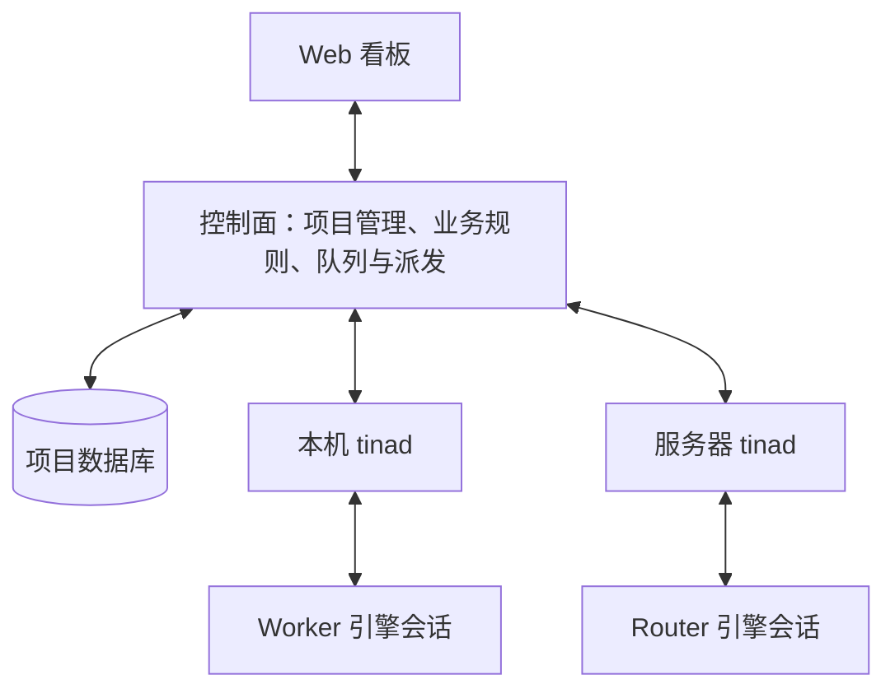

# 下一步实施修改计划

> 修订 7 · 2026-11-09 · P1–P4 已落地；下一阶段 P5
> 目标：把 H0 的闭环迁移到“控制面维护项目，tinad 承载 Agent 执行”的架构。
> 本计划是 H1 的前置架构修改，不等于 `1.0.0` 的完整范围或发布承诺。产品与架构共识见 [vision.md](vision.md)。
> 开始 P1、P3 或修改取消与恢复能力前，读取 [引擎适配契约](engine-adapter-contract.md)。
> 修改代码前先读 [工程架构](architecture.md)，区分目标边界与尚未迁移的 H0 实现。

## 1. 已确定的边界

1. **控制面是项目管理后端，也是项目业务数据的权威写入方。** 项目、成员、任务、计划、审批、Run、报告、产品事件和 Router 显式记忆由控制面维护。
2. **控制面不运行 Agent 引擎。** 它执行权限校验、审批、状态推导、排队与派发等确定性规则；需要模型判断的工作交给 Router。
3. **原“节点运行时”统一命名为 `tinad`。** 它部署在个人电脑或服务器，负责机器与 Agent 注册、通信、引擎会话、执行环境、结果回传和取消。
4. **取消“家节点”模型。** 项目数据不随执行位置迁移。tinad 可以保存引擎日志、工作目录、执行缓存和待回传记录，但不维护另一份权威项目库。
5. **Router 和 Worker 使用同一套接入机制。** Router 可以运行在本机，也可以运行在独立服务器上的 tinad 后面；其执行位置与项目数据归属分开。
6. **适配按引擎接口或协议族复用，默认在 tinad 内部实现。** 多个 Agent 共用工厂和适配代码，每个会话保留独立状态；使用引擎原生协议或 SDK，外置适配进程按需提供。
7. **控制面、tinad 与普通引擎适配器使用 Go。** dsh 进程内插件按其扩展机制使用 TypeScript；特殊 SDK 接入按需外置。Web 和现有 CLI 保持 TypeScript，不因本次选择扩展重写范围；tinad 不引入 Effect。
8. **能力声明、输入投递、执行终态和资源清理分别验证。** 停止信号或命令回执不能替代执行结束证明，结果未知时先对账。

## 2. 现状与修改方向

| 位置 | H0 基线实现 | 迁移目标 |
|---|---|---|
| `services/control-plane` | 提供 Web、内存目录、心跳和请求转发；不存任务 | 增加持久项目库、业务规则、Agent 目录和执行派发 |
| `packages/node-runtime/src/db.ts` | 维护 task / run / report / approval / event | 将产品数据模型迁到控制面；tinad 仅保留执行所需的本地状态 |
| `packages/node-runtime/src/service.ts`、`domain.ts` | 建卡、拆卡、审批、派活和状态推导 | 将业务规则移到控制面；模型调用改为执行请求 |
| `packages/node-runtime/src/connection.ts` | 注册节点及两个演示项目，接收业务 RPC | 改为注册 tinad 及 Agent，接收执行命令并回传事实 |
| `packages/node-runtime/src/engine-run.ts` | 启动适配进程，发送一轮输入，收集事件后关闭 | 迁为 Go tinad 的执行管理、会话实例和通用进程监管；Run 与具体活动关联，结束一次 Run 不默认删除会话 |
| `packages/engine-port`、`packages/engine-dsh` | TS 接口、TCP 传输与 dsh 进程外适配器 | 语义落实为 Go 内部接口，dsh 模块直接驱动原生协议；补持久句柄、能力验证与取消结果 |
| `apps/web` | 业务请求经控制面转发给节点，轮询看板 | 直接读取控制面项目数据，区分执行位置离线与项目可用性 |
| `apps/cli`、`Makefile`、`demo.sh` | 启动 H0 各组件并演示闭环 | 接入新的控制面数据库和 tinad 启动方式，继续支持一条命令本地运行 |

表中的目录是 H0 实现位置。P1 已在 `services/tinad` 建立 Go 适配接口、注册表和 fake，在 `packages/protocol` 建立共享 Go 消息与 JSON v1 编解码。P2 已把项目 API、业务、SQLite 存储及队列移到控制面；CLI 已停止自动启动旧 TS 节点，新的模型请求保持 queued，待 P3/P4 接通。原 TS 实现继续作为隔离的行为基线，避免长期维护两套生产项目服务。

## 3. 修改后的调用链

控制面收到拆卡请求后，保存请求上下文并派给承载 Router 的 tinad。Router 返回计划建议，控制面校验并创建待批记录；人批准后，控制面创建任务并按策略派发。Worker 的执行事实和报告回到控制面，由控制面落库、推导卡片状态并提供终审。

只有使用本机 Agent 时，用户电脑才需要运行 tinad。控制面可以自托管在本机、内网或服务器；项目集中维护不等于必须使用云服务。

## 4. 实施顺序

### P1 明确数据模型与执行契约

**状态：已完成契约定义和离线验证。** 字段、状态规则、完整业务路径及可读取样例见 [执行协议 v1](execution-protocol.md)。Go fake 验证多会话、去重、恢复拒绝及取消竞争；这不代表网络服务、持久幂等、项目业务或真实 dsh 已迁移。后续阶段继续实现并验证这些运行行为。

**工作**：

- 按第 1 节划分控制面业务、tinad 执行管理和引擎适配三个边界。
- 分开控制面与 tinad 的网络执行协议、tinad 内部 Go 适配接口；内部模块调用不强制经过自定义 TCP。外置实现遵守同一语义，传输方式另行封装。
- 区分 Agent 身份、Run、逻辑会话、原生持久句柄、当前活动和进程实例。Agent 的项目归属、角色、配置与 tinad 绑定保存在控制面；注册同时报告本机可用的引擎与能力。
- 定义注册、派发、输入、取消、执行事件、结果和重连对账消息。消息至少能关联命令、Run、Agent、tinad、会话和活动；可重传事件必须有稳定标识或序号。
- 按适配契约定义注册表、工厂和会话实例；最小操作覆盖可用性探测、创建／恢复、输入、事件、活动中断、运行时释放及按能力提供的交互回复。无实现的可选能力明确拒绝，不返回空成功。
- 定义“命令已接收”“执行已启动”“执行已结束”的不同含义；取消能力要区分保留会话的取消与关闭进程的降级方式。
- 定义已接纳待确认、已接受、已拒绝和结果未知的投递结果，以及活动终态、父进程退出和工具工作负载清理的独立证据。
- 规定 Router 建议经过控制面的业务校验、策略、审批与审计路径；tinad 不接受建卡、批计划、终审等项目管理 RPC。

**完成条件**：网络执行协议与内部 Go 适配接口分别给出可供实现的定义；用消息样例走通建卡、Router 拆卡、审批、派 Worker、报告、终审和取消。补齐重复派发、恢复拒绝、投递未知、节点离线及完成与取消竞争的处理规则；线协议不依赖 Go 内存类型或某个 SDK。适配层的验收以 [契约第 8 节](engine-adapter-contract.md#8-验收与参考范围) 为依据。

### P2 将项目存储和业务规则移到控制面

**状态：已完成。** 新的项目服务与启动方式见 [控制面项目服务](control-plane.md)。无节点时仍可管理项目；Go 测试验证持久的计划审批、报告和终审，真实进程测试验证重启后项目、卡片与原队列 ID 保留。业务与产品事件同事务，homeNodeId 转发已移除。新队列尚未实际派发；这不等于 P4 的自动执行闭环已恢复。

**工作**：

- 在 `services/control-plane` 增加持久数据库；本地部署默认使用文件数据库，内存库用于测试。
- 迁移任务、Run、报告、审批、事件及状态推导规则；补上持久的项目与 Agent 记录。业务变更和相应产品事件在同一事务中提交。
- Web 的建卡、读看板、审批和终审请求在控制面处理。需要模型的拆卡请求持久化后进入执行队列，不在控制面启动引擎。
- 删除以 `homeNodeId` 查找项目库的依赖。演示项目由控制面初始化或创建，tinad 注册不再决定项目是否存在。
- 明确队列、等待执行位置和实际运行的展示规则；业务状态只在控制面推导，tinad 上报执行事实。

**完成条件**：没有 tinad 在线时仍能创建项目与卡片、读取已保存的看板和报告、处理已有审批；控制面重启后数据保留。项目读写路径不再依赖旧节点项目库。

### P3 将原节点实现收敛为 tinad

**状态：已完成执行服务基础。** Go tinad、fake/dsh 内部适配器、跨平台进程监管、持久命令与回传日志已实现；真实子进程和 WebSocket 测试通过。部署与能力边界见 [tinad 执行服务](tinad.md)。控制面的正式接线仍属 P4，取消入口与异常处置属 P5；真实 dsh 模型及跨环境部署验收在 P6 完成。

**工作**：

- 在 `services/tinad` 实现 Go 执行服务，迁移注册、心跳、重连、引擎启动和事件收集能力，不迁入本地项目业务服务与权威任务库。
- 增加 Go 引擎定义与适配工厂注册表，fake engine 与 dsh 默认作为内部模块。dsh 直接使用原生 stdio 协议；共享协议族复用公共传输和生命周期，差异放在启动配置及薄的差异处理。仅当特殊 SDK 或引擎内部能力确有需求时增加外置宿主或插件。
- 注册 tinad 身份、归属和资源能力，并同步本机 Agent 的身份、角色、引擎类型、配置引用、绑定和可用状态。配置及凭据边界由协议明确，凭据不随注册明文广播。
- 使用同一机制承载 Router 与 Worker，支持一个 tinad 管理多个 Agent。注册成功不要求所有 Agent 已启动常驻进程。
- 会话实例独立维护原生句柄、活动和订阅。恢复使用引擎真实身份，不以 PID 代替；恢复不可用或被拒绝时明确回传，不静默创建新会话。
- 执行控制面的请求时校验本机授权和容量；关联 Run、会话、活动和进程实例，回传启动、进度、终态及报告。注册表检查声明能力是否存在实现，实际会话按可用能力收窄。
- 抽出公共进程监管，覆盖启动失败、退出观察和各操作系统的进程树清理；适配器只补充引擎特有的协议与资源释放逻辑。
- 为尚未被控制面确认的执行事件和结果保留最小可恢复记录，重连后补传；引擎原生转录保留在引擎侧。

**完成条件**：Go tinad 不持有权威 task / approval / report 数据；fake engine 与 dsh 通过统一 Go 注册表、工厂和会话契约接入，不要求额外启动普通 TS 适配进程。多个同类 Agent 复用实现且会话状态不串线；能力缺失和恢复拒绝可明确诊断。Router 与 Worker 均可调用；离线、上线和重复注册不会创建新的项目或重复 Agent。

### P4 在新边界上恢复完整闭环

**状态：已完成自动闭环接线。** 控制面在发送前持久保存完整 dispatch，核验已登记节点及 Agent 绑定，收到事实后同事务去重、落库和更新业务。Router 请求携带项目事实与控制面显式记忆；回执、开始和终态分开处理。两个独立 Go tinad 的完整 HTTP/WS 场景及控制面重启已验证，节点不共享项目数据库。取消与异常处置继续在 P5 实现；跨环境与真实模型验收在 P6 记录。

**工作**：

- 控制面保存 Router 的身份、配置和业务上下文，通过 tinad 调用引擎，接收计划建议并校验。先复用已有项目事实构造上下文，长期记忆的压缩与检索策略另定。
- 批准计划后由控制面创建任务、检查依赖、建立 Run 并派发；tinad 确认启动后才记录实际运行。
- Worker 回传结构化报告，控制面校验、落库并推导“评审中”；人终审仍由控制面处理。执行失败且没有有效报告时，控制面按已有事实生成醒目标记的兜底报告。
- 对派发和结果接收做幂等处理；控制面重启后恢复待派发记录，对已派发或运行中的记录先与 tinad 对账，再决定是否需要人工处理或重新尝试。

**完成条件**：fake engine 的完整闭环在新架构下通过；重复命令不重复执行，同一结果重复上报不重复生成报告。验证两个 tinad 分别承载 Router 和 Worker，不依赖同机部署或共享项目数据库；自动测试可用独立进程模拟，之后做一次实际分机验收。

### P5 接通取消与异常对账

**工作**：

- 为排队和运行中的 Run 提供取消入口，持久记录取消请求及发起人。未派发的工作可直接撤销；正在执行的工作等待 tinad 回报停止结果。
- tinad 针对当前活动将取消传到引擎，等待终态并处理相关工具进程。分别回传中断、运行时释放及父进程／工具工作负载的退出证据。先核对当前 dsh 版本的对外能力，按需补桥接；保留会话的取消与关闭进程的降级要明确区分。
- 覆盖断连期间取消、重复取消、完成与取消竞争、引擎崩溃及工具子进程残留。断连只改变可用性，不凭空证明执行已结束。
- 对不能证明已停止的执行保留待对账状态；不因超时就自动启动第二次可能有副作用的执行。

**完成条件**：收到取消请求不等于立即标为 `cancelled`；已有终态不被迟到消息覆盖，也不因等待超时就合成取消完成。支持会话取消的接法能够停下当前执行后在同一会话继续；降级接法明确记录关闭进程及其对续跑的影响，进程清理无法证明时明确报告。取消一个 Run 不终止 tinad 或其他 Run。

### P6 更新界面、启动方式、迁移与验证

**工作**：

- Web 展示控制面保存的项目事实和 Agent / tinad 可用性，增加取消请求与执行终态的区分，节点离线时保留项目操作入口。
- 更新 CLI、构建和 demo，显式配置控制面数据库与 tinad 连接，保留本地一条命令启动。浏览器始终访问控制面。
- 按第 5 节处理已有 H0 文件数据库，清理旧的项目路由和双写路径。
- 更新 Go 测试、启动方式与 CI，验证第 6 节的验收项；切换到 Go tinad 二进制并移除旧 TS 生产执行入口，保留仍有验证价值的场景数据。
- 同步根 `AGENTS.md`、启动说明及相关架构引用，移除“Effect 必须先装回”“项目归家节点”等过时指引。H0 规格和验收报告保持历史内容。

**完成条件**：新用户按启动入口即可完成新闭环；数据库路径和数据保留行为明确，离线和失败场景不会被界面呈现为成功。当前架构、启动命令和代码目录的说明一致。

## 5. 数据迁移与切换

- 先保留 H0 数据库快照，停止旧版执行进程，再导入已有任务、Run、报告、审批和事件，保留 ID、引用关系、人工覆盖及事件顺序。
- 旧库只有 `:memory:` 时无持久数据可导入；使用空控制面库按新流程创建项目即可。
- 迁移时仍标为活跃的旧 Run 不自动重跑。确认旧执行进程已停止后，将其标为失败并记录迁移中断原因；执行结果未知时先核查工作目录与外部状态。
- 导入应可检测冲突和重复，失败不破坏原库。回退时使用保留的快照和旧版本，不能把新控制面库直接交给旧节点写入。
- 切换后，Web 和控制面只使用新的项目存储；旧库仅作为历史快照，避免出现两处可写的项目状态。

## 6. 整体验收

| 编号 | 场景 | 可检查的结果 |
|---|---|---|
| A1 | 仅启动控制面 | 可创建和查看项目、卡片，读取历史报告和处理已有审批；没有引擎子进程 |
| A2 | 重启控制面 | 任务、审批、报告、事件及待派发记录仍在；运行中记录先对账，不盲目重跑 |
| A3 | 注册本地与服务端 tinad | Router 与 Worker 均通过同一契约接入，项目归属不随执行位置变化 |
| A4 | 完整任务闭环 | 建卡 → Router 计划 → 批准 → Worker → 报告 → 终审；每个业务结果只在控制面权威落库 |
| A5 | 断连与重复消息 | 离线不清空项目；重连补传可去重；重复派发不会产生第二次执行 |
| A6 | 取消 | 请求与停止确认分开；终态竞争有确定规则；其他 Run 不受影响，工具进程得到处理 |
| A7 | 迁移已有文件库 | ID 和关联保留、冲突可诊断、原库可保留回退，无旧新双写 |
| A8 | 离线自动验证及真实 dsh 手验 | `make verify` 继续无需网络或真实模型；另用真实 dsh 验证协议、报告与已声明的取消能力 |
| A9 | 适配复用与多会话隔离 | 多个 Agent 使用同一引擎实现，会话句柄、活动、事件和取消互不串线；缺少实现的能力声明被拒绝 |
| A10 | 原生会话恢复 | 释放后使用真实句柄恢复，不能恢复时明确说明；不以新建会话或重新生成 ID 冒充恢复 |

自动测试重点覆盖数据归属、业务规则、协议幂等、状态竞争和进程生命周期。测试数量随修改变化，不以维持 H0 的 32 条为目标。

## 7. 本轮暂缓的决定

| 项目 | 当前处理 |
|---|---|
| 具体接入是否需要外置适配器或引擎内插件 | 默认 tinad 内部模块；存在独立运行时或内部能力缺口时再决定扩展方式 |
| 传输契约的生成工具 | 先确定消息语义；是否使用 protobuf / Connect 单独评估 |
| Worker 真实改代码与制品文件传输 | 单列能力与验收；H0 的报告联调不能当作真实交付证据 |
| 完整 Router 记忆策略、桌面打包、托管沙箱等 | 后续规格明确，不隐含加入本次架构迁移 |

H0 报告中“先装回 Effect”的建议属于旧架构下的阶段结论。新方案采用 Go tinad 与 Go 普通适配器；取消与恢复仍以可观测行为验收，不因语言选择而降低引擎协议和进程清理要求。
