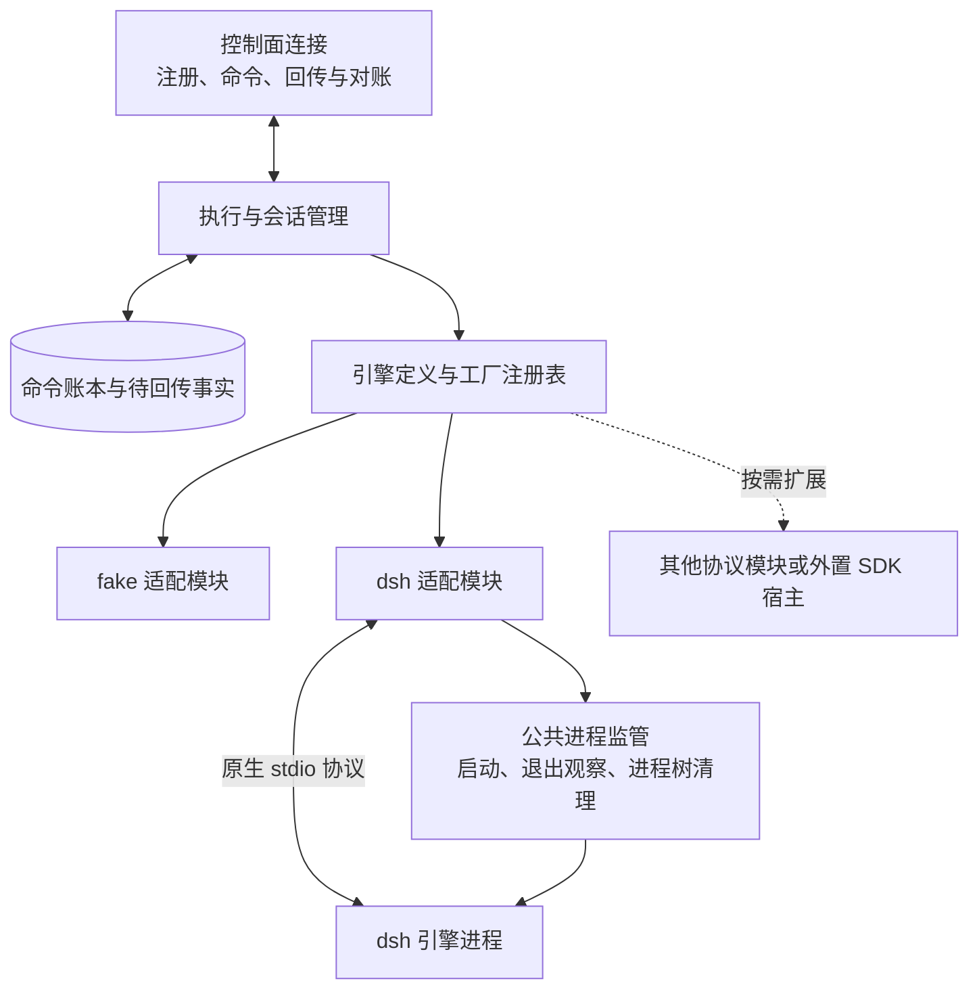

# tinad 执行服务

配置或修改节点接入、执行资源、引擎和本机权限时读取本文。系统边界见 [架构入口](architecture.md)；消息定义见 [执行协议](execution-protocol.md)，引擎操作语义见 [适配契约](engine-adapter-contract.md)。

tinad 执行已授权的 Agent 请求，管理本机资源与执行事实，不持有项目业务库。Router 和 Worker 使用相同的接入方式。

## 内部结构



连接层接收控制面的执行命令，并回传带稳定身份的事实。执行管理检查本机授权与容量，选择会话实例并记录命令；注册表按引擎类型选择工厂，公共进程监管负责 tinad 持有的进程与工具工作负载。

工厂、会话和原生句柄的职责及复用规则见 [适配契约的注册与复用](engine-adapter-contract.md#2-注册与复用)。

## 本机授权与配置

配置包含 nodeId、name、url（ws/wss 执行端点）、私有 token、database、maxConcurrent、roots，以及本机允许的 agents（id/projectId/role/engineId）。token 只用于本机私有配置与握手 Authorization 头，不进入注册消息或普通日志。

请求中的工作目录经真实路径解析后，必须处于 roots 内；Agent、项目及引擎绑定必须匹配本机清单。roots 限制工作目录选择，工具进程仍以当前操作系统用户身份运行。

控制面保存 Agent 的项目角色和执行绑定，本机配置保存机器所有者授予的执行权限。注册时两者必须匹配，登记流程见 [控制面身份登记](control-plane.md#节点身份与执行绑定)。

```json
{
  "nodeId": "server-1", "name": "Server Worker",
  "url": "ws://CONTROL_HOST:7801/ws/tinad",
  "token": "REPLACE_WITH_PRIVATE_RANDOM_TOKEN_32_CHARS_OR_LONGER",
  "database": "/var/lib/tina/tinad.db", "maxConcurrent": 2,
  "roots": ["/srv/work"],
  "agents": [{"id": "worker-proj-website", "projectId": "proj-website", "role": "worker", "engineId": "fake"}]
}
```

roots 和 agents 的文件变更会热更新并重新注册，已授权活动继续执行；身份、连接或引擎启动配置变化需要重启。CLI 的 autoProjects 选项负责同步本机项目授权，其使用方式见 [本地运行](../README.md#本地运行)。独立 tinad 按明确配置的清单接收请求。

## 持久执行与连接恢复

执行数据库与控制面库独立，以 TINJ application_id 标识归属，保存 command 与 outbox 两类记录。独占文件锁防止多个 tinad 同时拥有同一份日志。

命令身份在创建会话或提交输入之前持久登记。outbox 中的消息保留稳定 ID，控制面持久确认后才删除；命令账本继续保留，用于后续去重。线协议的重复投递及确认规则见 [执行协议](execution-protocol.md#5-重复断连与恢复规则)。

连接的生命周期独立于引擎活动：断连时暂存执行事实，重连后补传。服务重启后，缺少终态的旧命令记录为 unknown，并保留待核查容量；对账机制见 [重复、断连与恢复规则](execution-protocol.md#5-重复断连与恢复规则)。

引擎原生转录留在引擎自己的持久目录，执行数据库只维护命令与事实关联。恢复会话使用原生句柄，身份与生命周期见 [适配契约](engine-adapter-contract.md#3-身份与持久句柄)。

## 停止与资源管理

取消命令独立登记，并指向确切的活动和执行实例。构造会话期间收到取消会阻止后续提交输入；取消回执在目标活动结果持久保存后返回。停止证据及终态竞争遵循 [接受、终态与取消](execution-protocol.md#4-接受终态与取消)。

退出时先停止本机活动、持久保存结果，在控制面连接仍可用时最多补传 3 秒；未确认的数据保留到重连。CLI 通过私有配置的 stopping 标志触发这一关闭流程。

支持 turn 取消的会话可在中断后保留有限数量的空闲实例，后续输入继续使用原实例。配置变化或空闲实例释放后，使用原生句柄恢复。关闭运行时与删除历史的区别见 [适配契约](engine-adapter-contract.md#6-取消与资源释放)。

公共进程监管在 Windows 上先挂起创建引擎，加入带 kill-on-close 的 Job Object 后再恢复执行，使工具后代从启动起处于同一受管范围。停止后分别观察根进程与 Job 的活跃进程数。Unix 使用独立进程组并观察组退出。

## 引擎接入

### fake

fake 提供可人工控制的会话和 scripted 演示模式。每个会话独立维护状态，支持 turn 中断和同一 Driver 内的原生句柄恢复；新 Driver 不持有旧的内存历史。fake 没有 OS 子进程，对应进程证据为 not_applicable。

### dsh

dsh 适配模块直接驱动原生 stdio JSON-RPC，每个会话使用独立引擎进程。本机配置的 dsh.command 是可执行文件与独立参数数组，可设置 profile/provider/model/home；控制面请求不能替换可执行文件或凭据。

原生事件确认会话后，适配器发布真实句柄。恢复调用 session/resume，同时核对原持久目录与工作目录。初始化时使用缺少必要参数的请求检查方法是否存在，该请求不创建会话或发送输入：0.2.0-rc.2 缺少该方法，句柄记录 resume=false；0.2.2-rc.1 提供该方法。

dsh 适配器发布 process 取消能力：先尝试原生 shutdown，再用公共进程监管确认引擎及工具退出。历史保留，运行实例被释放，续跑需要恢复原生会话。交互回复等操作按会话实际能力开放。

sdk-minimal profile 的凭据服务与会话压缩配置由本机 dsh 管理。需要读取 DSH_HOME/.credentials.yaml 时，在对应 profile 的 cordis.patch.yml 配置 `@deepseek-ai/dsh-credentials-local`，或使用原生支持的环境变量认证。持久目录中的历史压缩格式需要与 profile 匹配。启动环境变量和配置示例见 [使用真实 dsh](../README.md#使用真实-dsh)。
