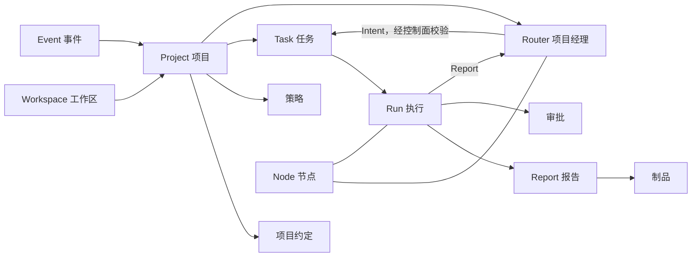
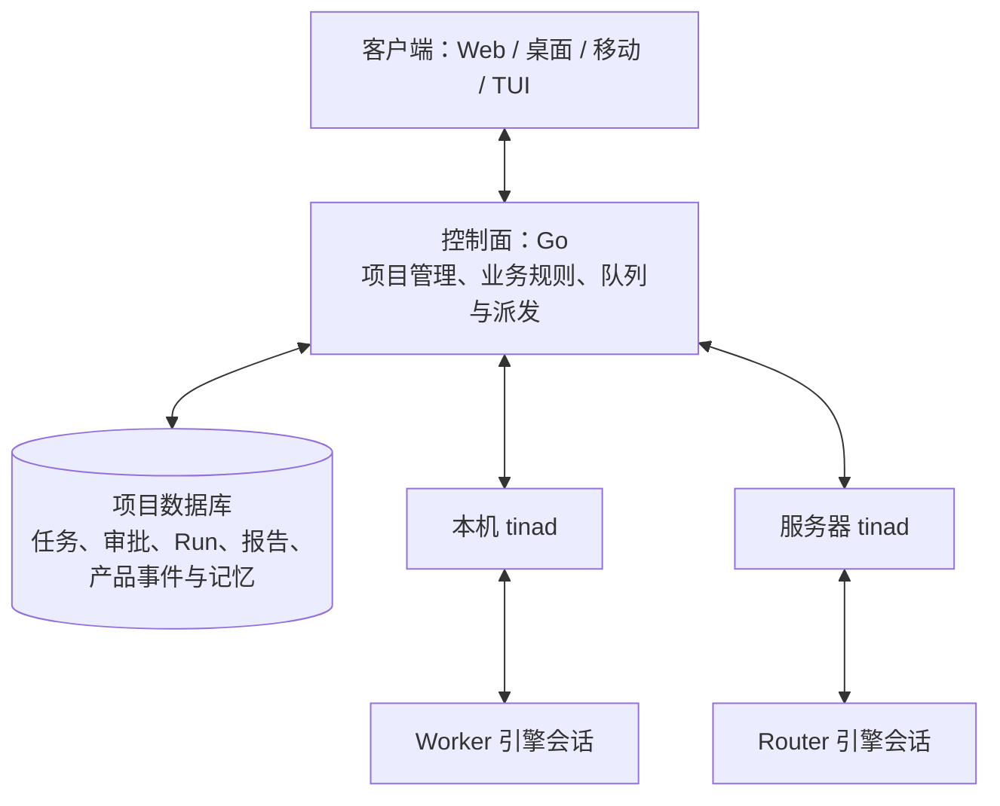
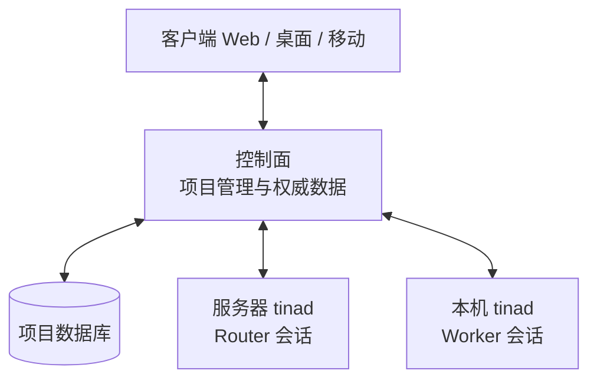
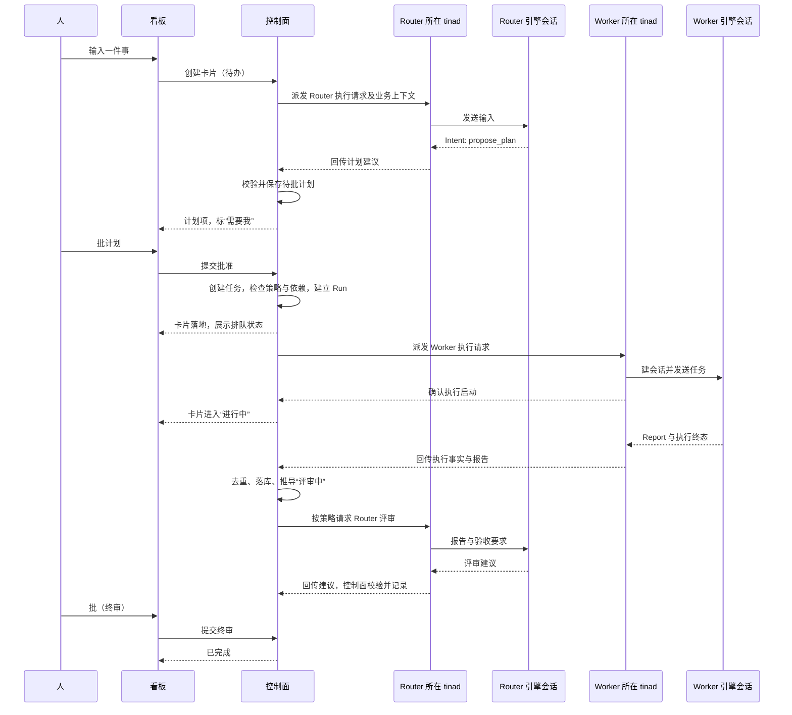
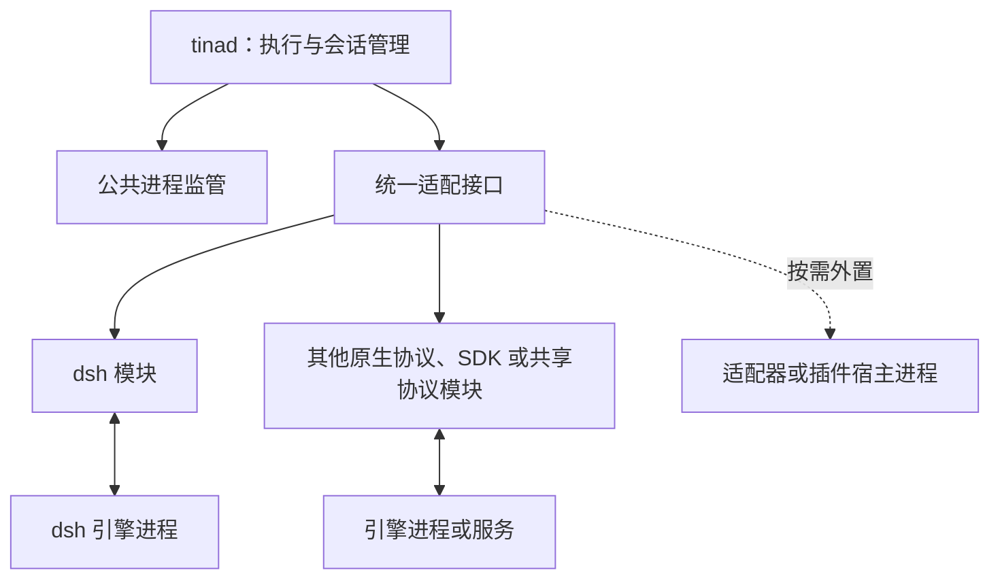

# Tina：产品最终形态

> 状态：**修订 9 · 2026-11-09** · tinad 与普通适配器已选 Go；P1 契约、P2 控制面存储与业务已落地，执行链路待 P3/P4 接通。已发布版本仍为 H0 `0.1.0`。
> 本文档回答三个问题：产品故事、架构设计、技术选型。
> 控制面维护项目权威数据，`tinad` 管理 Agent 执行，取消“家节点”模型。控制面、tinad 与普通适配器使用 Go；dsh 进程内插件按其扩展机制使用 TypeScript。
> 普通适配器默认采用 tinad 内部 Go 模块，按引擎接口或协议族复用；特殊 SDK 接入按需外置。实现时读取 [引擎适配契约](engine-adapter-contract.md)。
> 工程架构、数据归属与架构图见 [architecture.md](architecture.md)。
> 实施顺序与验收见 [下一步实施修改计划](next-implementation-plan.md)。历史决策见 [决策记录](2026-11-05-design-log.md)；版本规则见 [版本号与发布](versioning.md)；已交付规格和结果见 [H0](h0.md)、[H0 验收报告](h0-report.md)。

---

# 第一部分 · 产品故事

## 1.1 一句话

**Tina 是一个以任务看板为中心的项目空间。**

人、智能体、事件在同一个项目里协作。AI 干的活不再是会话，而是项目里可追踪、可验收、可接续的工作。

## 1.2 要解决什么问题

今天的 agent 产品，默认场景是"一个人、一台机器、一个 agent、一次对话"。

这个默认假设漏掉了三件事：

| 症状 | 表现 |
|---|---|
| **工作被困在会话里** | 关掉窗口，任务就找不到了；下次接着做，得重新交代一遍 |
| **项目管理和执行是两张皮** | 看板里记着"要做什么"，agent 在另一个窗口里"做"，两者不通信；进度靠人手工同步 |
| **多个 agent 各自为战** | 一个人推几条线时多开窗口，靠脑子记哪个任务在哪个窗口里 |

根问题是：**把 AI 融入项目管理。**

这句话容易被理解成两件更简单的事，但都不是我们要做的：

- 不是**给项目管理配一个 AI 助手**（写、查、总结、提醒）。这是功能层，会被现有的项目管理工具吃掉。
- 不是**给 AI 配一个任务列表**。那只是把 agent 的待办搬到另一个窗口里，两张皮还是两张皮。

我们要做的是：**让项目本身成为 AI 工作的容器。**

任务在哪，AI 就在哪；AI 做到哪，项目就记到哪。人不需要在"agent 窗口"和"项目管理工具"之间搬运信息——因为只有一份信息。

## 1.3 场景

**谁**：一个人管多个项目的开发者。之后是小团队。
**频率**：一天十几次，不是一天一次。
**核心循环**：

```
想到一件事 → 扔进去 → 去干别的 → 回来验收
```

**一天的样子**

| 时间 | 发生什么 |
|---|---|
| 08:12 | 打开总控台。三件事在等我：两个要批，一个要我选方案 |
| 08:20 | 批掉两个，第三个改了一句需求，打回去 |
| 09:30 | 想到一个 bug。在输入框里写一句话，回车 |
| 09:31 | Router 给出计划：拆成两张卡（修 bug、补回归测试），排好先后，等我在计划上批 |
| 09:35 | 我批了计划，两张卡进入"进行中" |
| 11:00 | 手机上打开看板：修 bug 在"评审中"，测试在"进行中" |
| 18:40 | 回来看结论：PR 链接、根因、两处决策理由。点"批" |

**触发来源**：自己想到、PR 上被 @、CI 失败、线上告警、定时复盘。

**不在这里做的事**：写代码补全、跑 CI、管发布流水线。

## 1.4 产品形态

**一个项目空间。** 里面只有三样东西：

| 组成 | 是什么 |
|---|---|
| **任务看板** | 项目里所有工作的唯一入口与唯一真相 |
| **成员** | 人 + 智能体。智能体是成员，不是工具：有名字、有头像、有当前在做什么 |
| **约定与策略** | 约定写"怎么干活"（进仓库，可 diff）；策略写"能干什么"（结构化配置，可审计） |

智能体分两种角色，都出现在成员列表里：

- **Router（项目经理）**：身份和显式记忆挂在项目上，由控制面维护；负责拆解、排期建议、跟进、验收和汇报。实际会话由某个 `tinad` 承载，可以在本机或服务器运行，进程不必常驻。
- **Worker（工程师）**：挂在具体任务上。动手、产出、交付、退场。通过 `tinad` 注册并接受执行请求，在该 tinad 所在机器的工作环境中干活。

**项目管理由控制面维护，Agent 执行由 tinad 承载。** 用户使用本机 Agent 时需要安装 tinad；只使用服务端 Agent 时可以仅通过浏览器访问。

**它不是什么**：不是聊天软件，不是 IDE，不是又一个 Jira，也不是一个更聪明的终端。

**和相邻产品的关系**

| | 它们擅长 | Tina 的差别 |
|---|---|---|
| 单机 agent harness（pi、Claude Code、DeepSeek Harness） | 一个人、一台机器上的一次工作会话 | 把它们当作**可替换的引擎**，在其上做项目与协作 |
| 云端异步 agent（Devin 类） | 一个云端沙箱里跑一个长任务 | 我们做**多任务 + 多智能体 + 本地云同构** |
| 项目管理工具（Jira / Linear） | 记录和管理**人**做的工作 | 这里的任务**由智能体执行**，状态自动流转 |
| 通用 IM / 协作工具 | 人和人的沟通 | 智能体是**一等成员**，不是被 @ 的机器人 |

## 1.5 交互：以任务看板为中心

这是本产品最重要的一条决定。它决定了产品长什么样，也决定了哪些东西我们不做。

### 1.5.1 两个界面

**首页 · 跨项目总控台**

回答一个问题：**现在需要我做什么？**

| 区块 | 内容 |
|---|---|
| **需要我的** | **凡"下一步只能由人做"的事**：分配给我的待办、计划审批、验收、二选一、冲突裁决 |
| **正在跑的** | 谁在做、做了多久、卡在哪 |
| **项目列表** | 每个项目一行：进度、卡住的数量、最近活动 |

> 第一块不限于"审批"。它是一张**人的工作队列**：agent 做不了的事（打电话确认、去机房插根网线、判断一个需求要不要接）也在这里。
> 判断标准只有一句——**下一步动作只能由人来做。**

**项目页 · 看板**

四列：`待办` / `进行中` / `评审中` / `已完成`。

- 列表示**生命周期状态**。
- 任务之间可以有依赖，卡上标出"被谁挡着"。
- 一个任务可以有多个执行者（v1 只实现单个）。

### 1.5.2 任务卡

卡片正面只有四件事：**标题 · 负责人 · 状态时长 · 产出物。**

**负责人可以是人，也可以是智能体。** 人负责的卡片，状态由人推进（只有他知道做完没有）；智能体负责的，状态由执行推导。

右上角一个标记：**需要我**。它横跨所有列——因为"等我拍板"不是一种状态，是一种注意。

点开是任务视图：对话、执行记录（每次尝试一份报告）、制品、审批历史。

### 1.5.3 四个动作

整个产品的交互原语只有四个。

| 动作 | 含义 | 用在哪 |
|---|---|---|
| **看** | 状态与产出 | 卡片、报告、制品 |
| **问** | 追问或补充要求 | 任务对话 |
| **批** | 审批 / 验收 / 二选一 | "需要我"的卡片 |
| **接** | 接管执行：人接手同一个工作区，智能体在旁边看着 | 进行中的任务 |

**"批"是最重要的一个。** 产品的大部分价值，是把"需要人判断的事"收敛到这一个动作上——不需要人盯过程，只需要处理卡在自己这里的东西。

### 1.5.4 从一句话到一张卡

输入框永远在。输入一句话，默认创建任务。之后分三种情况：

| 你输入的是 | 系统怎么处理 |
|---|---|
| 一件明确的小事 | 直接一张卡，进"待办" |
| 一个目标 | Router 给出计划（拆成哪些卡、顺序、谁来做），出现在"需要我"里等你批；批准后卡片才落地 |
| 只是一句话 | 先以**草稿卡**落在"待办"，不惊动 Router |

**计划要不要人批，由策略决定。** 默认要批；在授权范围内（比如"评审类任务直接执行"）可以跳过。故事 A 就是授权跳过的情形。

**注意最后一行**：聊天不是首页。会话是任务内部的一个面板，不是产品入口。当一句话还不构成任务时，它先变成一张草稿卡——因为账号、项目、任务才是产品里的一等对象。

### 1.5.5 移动端

**移动端有看板。** 四列都在，卡片能看、能问、能批。

另外两个必备能力：处理"需要我的"、对一张卡追问一句。

不做：接管（需要完整工作台）、编辑代码、本地智能体。

### 1.5.6 为什么是看板

三个理由，按重要性排：

1. **看板是"谁在做什么"的唯一真相。** 有它，才不需要靠脑子记任务在哪个窗口。
2. **卡片是收敛复杂度的单位。** 一个任务一个上下文，人不会被十几个并行会话淹没。
3. **列是状态，标记是注意。** 状态由执行推导，不需要人维护；人只处理"卡在我这里"的。

## 1.6 三个故事

架构如果正确，它应该能同时讲清楚下面三件事。注意三个故事都从**看板**开始，不从对话框开始。

**故事 A · 云 + 云（无人值守）**

周五夜里，PR 上被打了一个 `tina-review` 标签。项目看板自动多出一张卡片。这个项目的策略允许评审类任务跳过计划审批，于是 Router 直接派了两个 worker：一个逐行读 diff，一个在干净沙箱里跑测试和扫描——它按项目约定判断这是安全敏感改动。周六早上，卡片出现在"评审中"，附一条结论和两份可展开的证据。人只看那三行，点"批"。

**故事 B · 云 + 本地（数据不出内网）**

一个支付团队不允许源码离开内网。他们把控制面和项目数据库部署在内网，代码工作区由内网机器上的 tinad 管理。看板上有一张"调研 Stripe 新 webhook 重试策略"的卡片——它只需要公开文档，于是控制面按策略把必要的公开任务信息派给服务端 tinad，产物是一份带引用的笔记回传进卡片。全程没有一行私有代码离开内网。

**故事 C · 人 + 人 + 多智能体（冲突与接管）**

线上告警，看板上瞬间多了三张卡片。两个工程师同时进同一个项目：A 说"先回滚"，B 说"先看日志"。Router 不选边：它开了一张"决策"卡，标上"需要我"，写清两条路的代价，请人拍板；同时把两件不冲突的准备工作并行派了出去。B 顺手对一张卡片点了"接"，在那个工作区里手动跑了三条命令，智能体在旁边看着，之后接着他的状态继续。

## 1.7 目标与非目标

### 目标

- 一个人管多个项目时，**一个总控台看全部**，不需要靠脑子记任务在哪。
- 一个 PR 或 issue 事件，可以**无人值守**地走完：创建卡片 → 执行 → 自审 → 等人验收。
- 同一个项目里，本机和服务器上的 tinad **通过同一协议在场**；Router 与 Worker 可以分开部署，项目历史始终由控制面维护。平台托管沙箱另属长期形态，见 2.6。
- 换掉底层 agent 引擎，**产品不受影响**：人、任务、权限、历史全部保留。

### 非目标

- 不做模型训练/推理服务，不绑定任何一家模型。
- 不做通用工作流编排（不是低代码、不是 BPMN）。
- 不做通用 IM、不做 IDE、不做 CI/CD 系统。
- 不做手机端的本地智能体运行时。
- 不追求"全自主软件公司"：人定方向和验收，这一点在可预见的未来不变。
- 生活助手场景暂缓。

---

# 第二部分 · 架构设计

## 2.1 概念模型

层级只有三层：**工作区 → 项目 → 任务**。下面这些是要素，不是层级。

| 概念 | 定义 | 归属 |
|---|---|---|
| **Workspace 工作区** | 租户边界：成员、项目、策略、密钥、账单 | 控制面 |
| **Project 项目** | 一件持续产出的工作。拥有看板、成员、约定、策略和显式记忆 | 控制面 |
| **Task 任务** | 看板上的一张卡：目标、负责人、依赖、产物、审批 | 控制面 |
| **Run 执行** | 一次具体尝试：记录发起人、Agent、执行位置及执行事实 | 控制面建档并维护状态，tinad 上报执行事实 |
| **Report 报告** | 一次 Run 的结构化交付 | 控制面 |
| **Node 节点** | 一台部署了 tinad 的机器：个人电脑或服务器，归属个人或工作区 | 控制面登记，tinad 管理本机资源 |
| **tinad** | 机器上的常驻服务：注册、通信、会话、执行、取消与回传 | 本机或服务器 |
| **Agent 智能体** | 项目中的可调用成员：身份、角色、配置、可用范围和执行位置 | 控制面登记，通过 tinad 接入 |
| **Router 项目经理** | 提出计划、排期与派活建议，跟进、评审和汇报 | 身份与显式记忆在控制面，会话在某个 tinad |
| **Worker 工程师** | 执行具体任务并交报告，可按任务创建会话 | 身份在控制面，会话在某个 tinad |
| **项目约定**（`PROJECT.md`） | 人写给 Agent 的长期说明：目标、验收标准、禁区 | 控制面维护有效版本与来源；仓库文件可作为可版本化来源 |
| **策略 Policy** | 结构化规则：自主度、审批人、预算、数据边界 | 控制面维护工作区默认与项目覆盖；tinad 执行本机约束 |
| **Event 事件** | 人声、外部输入、意图和执行事实 | 产品事件由控制面持久化，引擎原生转录留在引擎侧 |
| **Artifact 制品** | PR、补丁、文档、报告、截图、测试结果 | 元数据与可访问性在控制面，文件可留在执行机器或按策略上传 |
| **Approval 审批** | 需要人或策略批准的动作及其结果 | 控制面 |
| **Intent 意图** | Router 产出的结构化动作请求 | 控制面校验、审批、执行或派发；需要引擎的动作交给 tinad |

控制面是项目业务数据的唯一权威写入方。tinad 保留的工作目录、引擎日志与执行缓存服务于执行和补传，不形成另一份可独立修改的项目库。

### 三层数据：Task / Run / Report

这是整个"执行 → 记录"链条的骨架。

```
Task（卡片，持久）
 │
 ├─ Run #1 ──── Report #1
 ├─ Run #2 ──── Report #2
 └─ Run #N ──── Report #N
 │
 └─ 结论（Router 合成，人看这个）
```

- **Task 比任何一次执行活得久。** 它可能被重试、被换人做、被打回重做。
- **Run 是一次尝试。** 每个 Run 有自己的耗时、用量、结果。
- **Report 挂在这个 Run 上。** 如果报告挂在 Task 上，第二次执行就会冲掉第一次——而"第一次为什么失败"恰恰是复盘时最有价值的信息。

由此得到两条规则：

1. **报告必须挂在执行上**，不挂在任务上。`Task 1:N Run`、`Run 1:1 Report`。
2. **卡片状态是推导出来的**：由 Run 的执行事实推出，不需要人维护，也不需要 agent 手动去改。（人负责的卡片没有执行者，由人自己推进——见 1.5.2。）但推导只是**默认值**：人一旦手动改状态，以人的为准，并在卡片上记一笔"人工覆盖"。推导是谓词，不是判词。

报告必须**有兜底**：执行者崩溃或执行确认失败且没有有效报告时，控制面根据已经收到的执行事实生成一份，标记为"自动生成"。需要补充的本机证据由 tinad 回传；断连或未收到消息本身不能证明执行已经停止。



## 2.2 两级智能体

### 为什么分两层

一个 agent 同时做"想清楚做什么"和"埋头做完"，会陷入长上下文、长任务、难恢复的状态。分开之后：

- **Router 便宜且稳定**：输入是摘要和记忆，输出是意图，失败可重试。它不读一万行代码，所以上下文增长是可控的——但这不等于它无状态，见下面的"Router 的记忆"。
- **Worker 深且可弃**：能读一万行代码，能在自己的工作区里炸掉，能换一个重跑。
- **出问题时能立刻判断**：是决策错了，还是执行错了。

### Router：项目经理

**做**：理解意图、拆任务、排优先级、制定计划、选执行者与放置、跟进、验收、决定何时问人、汇报。

**不做**：不读大量源码、不执行命令、不直接改文件。

**关键：Router 的能力按副作用分级，而不是按"工具数量"限制。**

| 等级 | 例子 | 形态 | 理由 |
|---|---|---|---|
| **只读** | 看板、任务历史、项目约定、记忆检索 | 工具 | 无副作用，越方便越好 |
| **低风险副作用** | 发消息、建卡、改状态 | 工具，但过策略 | 可撤销、影响面小 |
| **高风险副作用** | 改文件、跑命令、开 PR、调外部 API | **只能是意图** | 控制面统一校验、审批与审计，执行请求交给 tinad |

核心原则：**手里的工具不能"改世界"，只能"表达"。** 智能体的自由体现在"想"，不体现在"手"。

**意图集是开放的**——否则每加一个能力都要改产品代码。但执行管道必须统一：**所有意图走同一条「校验 → 执行 → 审计」的路**。否则迟早出现"某个意图忘了检查预算"。

这条业务管道由控制面维护。Router 负责模型判断与建议；控制面负责校验建议、落实依赖与审批、创建业务记录、排队和派发。Router 与 Worker 都经 tinad 注册和执行，控制面不加载或运行 Agent 引擎。

| 常见的意图 | 作用 |
|---|---|
| `propose_plan` | 提出计划：拆成哪些任务、顺序、优先级、谁来做 |
| `spawn_worker` | 派生执行者：任务、预设、放置、预算、验收标准 |
| `message` | 对项目、人、任务或执行者发言 |
| `ask_human` | 阻塞式提问或审批请求 |
| `update_task` | 状态、依赖、切分、优先级 |
| `cancel` | 停止某个执行 |
| `schedule` | 在未来某个时间点唤醒自己 |
| `finish` | 宣告目标达成或明确失败 |

### Router 的记忆

Router 和 Worker 最本质的区别不是"做什么"，是**记忆的形态**。

Worker 的上下文可以是一次性的：任务结束，会话就可以丢。Router 不行——它要记得这个项目为什么这样做、上次否决了什么、什么东西还悬着。

但"记住"不能靠"那个会话还开着"。进程会重启、机器会迁移、引擎会被换掉。所以 Router 的记忆必须是**显式的对象**，能存、能压缩、能重建：

| 记什么 | 存哪 | 形态 |
|---|---|---|
| 项目为什么存在、边界在哪 | 项目约定 | 人写，可版本化 |
| 做过哪些决定、为什么 | 决策记录 | 追加写，可检索 |
| 还悬着什么 | 未完成意图与待办 | 结构化 |
| 最近发生了什么 | 事件摘要 | 滚动压缩，有窗口 |

这些产品记忆的权威记录由控制面维护，与 Router 所在的 tinad 和引擎会话分离。具体机制（怎么压缩、怎么召回、多少进上下文、多久过期）还没定，**但"它不是无记忆的"已经确定**。

一条判据：如果 Router 的进程被杀掉、重启后要重新问人"我们上次说到哪了"，那这套记忆就是假的。

### 什么事件才唤醒 Router：快路径与慢路径

Router 挂在项目上，必须防止被日常琐事淹没。这里借计算机系统的 **Fast Path / Slow Path**：能用程序确定性判断的不进大模型，判断不了才交给 Router。

**快路径（控制面程序）**只比较平台已经存下的事实，输出三种结果：

| 判定 | 动作 |
|---|---|
| **处理** | 直接派发或执行，记一笔，不进 LLM |
| **忽略** | 丢弃并记账；被误杀的事件进收件箱，下一轮一起看 |
| **说不清** | 转 Router |

三态比二态多一个很便宜的保险：**程序可以承认自己不确定，而不是硬判。**

快路径的规则来自三处：项目约定里可判定的条件（"CI 红了派修复 worker"）、系统默认（去重、限流、自触发抑制）、Router 自己在运行中注册的唤醒。

**慢路径（Router）**处理剩下的事件。到了分诊层的事件按下面的规则分——表里的"直投"是在进分诊之前就完成的：

| 事件类型 | 例子 | 去向 |
|---|---|---|
| **记录型** | 任务进度、工具调用、日常输出、文件变更 | ❌ 只更新卡片与日志 |
| **决策型** | 需要拆任务、任务间冲突或依赖、失败重试、越权、超预算 | ✅ Router |
| **里程碑** | 任务完成、等待验收 | ✅ Router |
| **人声** | 任何人在项目或任务里发言 | 已归属任务 → 直投执行者；否则 Router（合并窗口内去抖） |
| **外部** | PR、CI、告警、webhook、定时 | 能判定走快路径；其余 Router |

**直通**：已归属某个进行中任务的事件，控制面记录后经 tinad 投给它的执行者，不经过 Router 的模型判断。

四条护栏：

1. 每个项目每小时的唤醒次数有上限，超限则合并或转人工。
2. 被拒绝的事件不丢弃，进收件箱等下一次唤醒一起看。
3. **自己造成的事实不唤醒自己**——执行者改了任务，不触发同一条执行链。
4. **已有排队中的 Run 时，新事件合并进那次 Run**，而不是再排一个。

### Worker：工程师

**接入方式只有一条：机器上运行 tinad，将本机和可调用 Agent 注册到控制面。** Router 与 Worker、个人笔记本与服务器使用同一套注册、心跳、派发、回传和取消机制。服务端 Agent 同样运行在 tinad 后面。

个人 agent 和团队 agent 的差别不在机制，在**节点归属**：

| | 个人 agent | 团队 agent |
|---|---|---|
| 节点在 | 本人机器 | 团队部署的服务器 |
| 谁能调用 | **只有本人** | 项目成员，按策略 |
| 执行边界 | 那台机器的操作系统用户 | 那台服务器的操作系统用户 |
| 用谁的凭据与额度 | 本人 | 项目 |
| 谁运维 | 本人 | 团队（将来可由我们代跑节点） |
| 产出 | 进共享看板（受数据边界约束） | 进共享看板 |

统一之后有两个好处：

1. **失败语义只有一套**。本机与服务器上的 tinad 都可能离线，控制面统一记录等待、执行、失败与对账状态。
2. **业务和引擎职责清楚**。控制面运行项目管理规则并维护数据；模型推理和工具执行都在 tinad 管理的引擎会话中发生。

**后果**：个人 agent 接的是"我自己的活"，团队任务应该派给团队 agent——否则别人 @ 它不会有反应。项目约定可以声明"个人 agent 的报告要本人确认后才进共享时间线"。权限怎么校验见 2.5。

- 任务级执行生命周期。H0 用一会话一引擎进程；后续是否复用进程由引擎能力和隔离要求决定。
- 完整工具面：读写文件、shell、测试、语言服务、浏览器、搜索。
- **执行环境由它所在的节点决定**。v1 不提供沙箱：Worker 就是跑在用户机器上的 dsh，能碰到什么由那个用户的操作系统权限决定（见 2.6）。
- 工作区来自项目绑定（克隆 / worktree / 卷）。
- 可选自审：交给人之前，派一个独立执行者做对抗性评审。

**必须交结构化报告**：

| 字段 | 内容 | 谁用 |
|---|---|---|
| 状态 | 完成 / 失败 / 阻塞 / 部分完成 | Router 决定下一步 |
| 摘要 | ≤ 一屏：做了什么、结论是什么 | Router、人 |
| 决策 | 关键取舍和理由 | 人复盘、审计 |
| 制品 | PR、补丁、报告、测试结果、引用 | 人验收 |
| 阻塞 | 需要谁回答什么问题 | Router 转成提问 |
| 用量 | token / 成本 / 耗时 / 工具调用次数 | 预算、成本 |

> 这份 schema 是整套架构里最容易被低估的东西：Router 不读执行者的完整转录（太贵、太长、噪声太大），只读报告。**它就是"协作的 API"。**

### 自主度

| 等级 | 含义 | 默认场景 |
|---|---|---|
| **L0** | 只读、只建议，所有动作需人执行 | 新人、敏感仓库 |
| **L1** | 在工作区内自由行动，不产生外部副作用 | 日常开发 |
| **L2** | 有外部副作用需人批准（开 PR、推送、发消息） | **默认** |
| **L3** | 全自主（合并、部署、对外沟通） | 明确授权的流水线 |

自主度由控制面和 tinad **共同强制**：控制面检查业务权限、审批和预算，tinad 检查本机授权、工作目录和执行边界。模型提示词不替代这些检查。

## 2.3 协作模型

**参与者**：人、Router（每项目一个）、Worker（每任务一个或多个）、外部系统。

**三条规则**：

| 规则 | 内容 |
|---|---|
| **发言权** | 人随时可说话；Worker 默认只通过报告发声；打断优先级 人 > Router > Worker |
| **冲突** | 两个人同时下指令时，Router 不选边，而是开一张决策卡，标"需要我"，写清代价，请人拍板 |
| **接管** | 人可以从执行者手里接过同一工作区，手动操作；智能体旁观，之后接着人的状态继续 |

**接管**是"人机协作"最真实的样子：不是人给 agent 派活然后等待，而是**两个执行者轮流用同一块工作台**。

**审批**是看板上的对象，不是聊天里的一句"可以吗"。谁有权批、需要几个人、超时怎么办，由策略决定。无人应答时按策略升级。

**主体（originator）**：每个 Run 都有一个发起人——谁下的令、花谁的钱、出事查谁。没有主体，多人工作区里"agent 开了个 PR"这句话就没有主语。

| 情形 | 发起人 |
|---|---|
| 人分配、批准、评论触发 | 那个人 |
| 系统事件（定时、CI、PR）触发 | 继承**项目责任人**；责任人不具体时继承规则创建人 |
| 共享的团队 agent 被调用 | **调用它的人**，不代表性它属于谁 |

审计记 `actor = agent, on_behalf_of = 人`。发起人失去权限后，排队中的 Run 不能开跑。

**跨项目没有 agent。** Router 挂项目，跨项目只有视图（总控台）。跨项目的协调由人升格成某个项目里的任务；将来真需要（D14 的计划能力），做成一个**工作区级的计划对象**——而不是第二层 Router，否则边界、记忆、权限全要重新定义一遍。

| | 人 + 人 | 人 + 智能体 | 智能体 + 智能体 |
|---|---|---|---|
| **共享什么** | 看板、任务对话、在场状态 | 对话、审批、**同一工作区** | 看板、结构化报告、消息 |
| **难点** | 多人同时写而不打架 | 人从智能体手里接管 | 跨机器、跨项目的通信与身份 |
| **答案** | 控制面事务与事件合并 | tinad 管理同一工作区并暂停执行 | 控制面记录与路由，Router 做需要模型判断的协调 |

## 2.4 系统分层



Router 与 Worker 的位置可以互换，也可以由同一个 tinad 承载。控制面和 tinad 可以部署在同机，但职责与数据归属不合并。

### 控制面的职责

**控制面是项目管理后端，维护全部项目业务数据和确定性业务规则。**

| 组 | 负责什么 |
|---|---|
| **项目管理与存储** | 项目、成员、任务、计划、审批、Run、报告、产品事件、显式记忆和制品元数据 |
| **业务推进** | 校验 Router 意图、策略与预算、依赖检查、排队派发、状态推导、失败与取消对账 |
| **身份与目录** | 账号与访问权限、tinad 配对及归属、Agent 身份、配置、绑定和可用范围 |
| **通信与同步** | 客户端 API、tinad 连接、执行事件和结果接收、去重确认、看板更新 |
| **入口、通知与治理** | Webhook、定时触发、通知、审计和配额；具体版本范围另列验收 |

控制面可以理解业务层的 Agent、Run、意图和执行事件，但不运行模型推理与工具循环，也不依赖某个引擎的内部类型。Router 提供语义判断与计划建议；控制面负责把经过校验的建议落实为正式业务记录和执行请求。

### tinad 的职责

**tinad 是机器上的 Go Agent 执行服务。** 原 TS“节点运行时”的执行职责迁入 tinad，业务职责移到控制面。

它负责：

- 注册本机身份、归属、能力和可调用 Agent，维持心跳、重连与状态同步。
- 接收执行请求，校验本机授权和容量，建立 Run 与引擎会话、进程的关联。
- 通过内部适配注册表管理引擎启动、会话、输入、事件与报告回传；公共进程监管负责退出观察和进程树清理，适配器补充原生取消协议。
- 管理本机工作目录、凭据引用、执行缓存、引擎日志和待确认的回传记录。
- 重连后补传执行事实并与控制面对账。

tinad 不处理建卡、计划审批或终审，不独立推导权威卡片状态。一个 tinad 可以管理多个项目中的 Agent，但项目库始终由控制面维护。

### 数据归属与故障边界

| 情况 | 行为 |
|---|---|
| tinad 离线 | 项目管理与历史读取仍可用；已有审批可处理，需要该执行位置的工作排队等待 |
| Router 不可用 | 项目管理仍可用，需要 Router 判断的工作等待；不影响读取历史和人工处理 |
| 控制面不可用 | 暂停新的平台派发与业务写入；tinad 已开始的执行可按策略继续或停止，结果暂存待回传 |
| 重连或控制面重启 | 按 Run 和事件标识补传、去重并核对状态；断连不等于执行失败或停止 |

产品状态通过控制面事务串行化相关变更。tinad 上的执行记录用于补传和恢复，不能在离线时修改另一份项目状态；正在运行但结果未知的工作先对账，再决定是否重试。

### 引擎

引擎由 tinad 管理，运行在独立进程中，通过适配接口驱动：

1. 引擎崩了不会带走产品状态。
2. 换引擎时改动面被端口挡住。
3. 不同引擎可使用各自的运行时和扩展机制，tinad 不必加载它们的内部实现。

## 2.5 tinad、Agent 注册与权限

**项目数据归控制面，执行位置归机器。** “家节点”及其迁移规则从目标架构中移除。更换 Agent 的执行位置只改变绑定和后续执行路由，不迁移项目库。

控制面登记 Agent 的项目归属、身份、角色、配置、可用范围和 tinad 绑定；tinad 上报本机注册信息及引擎能力。Router 与 Worker 使用同一注册机制，角色不决定部署位置。

注册表示某个 Agent 可被调用，不要求其引擎进程始终存活。Agent 是产品成员，Run 是一次业务尝试，引擎会话保存交互上下文，进程负责实际承载；这几个对象分别建模。

### 谁能用这台机器

**归属**在注册时确定，只有所有者能改。

| | 个人节点 | 团队节点 |
|---|---|---|
| 所有者 | 一个成员 | 工作区 |
| 谁能注册 agent | 所有者 | owner / admin |
| 谁能派活 | 所有者（可加白名单） | 全体成员（可缩到白名单） |
| 管理员能不能绕过 | **不能** | 不适用——它就是管理员在管 |
| 默认可见性 | 私有 | 全体成员 |
| 典型 | 我的笔记本 | 团队服务器、CI 机器 |

**两条不变量：**

1. **管理员有治理权，没有使用权。** owner/admin 可以吊销节点、移出工作区、看审计，但**不能**在别人的个人节点上建 agent 或派活——否则"这是别人的电脑"就不成立了。Multica 也是这条：连工作区 owner 都绕不过"仅自己"的运行时。
2. **派活要过两道门**：发起人有权运行这个 agent（agent 的可用范围），**且**这个 agent 所在的节点接受发起人（节点权限）。两道都过才派。派活用的是发起人的授权——这和 D42 是同一套。

**agent 的可用范围**是另一把锁，由 agent 的所有者设定，默认最紧：

| 档 | 谁能运行它 |
|---|---|
| 仅自己 | 只有 agent 所有者 |
| 指定成员 | 白名单 |
| 项目成员 | 该项目所有成员 |

两把锁管的是不同的事：**节点权限决定"能不能落到这台机器"，agent 范围决定"谁能让它干活"**。前者随机器走，后者随 agent 走。

**agent 属于项目，不跨项目。** 一个 agent 只在一个项目里存在；别的项目要用同样的能力，另建一个（可以绑同一个节点）。所以范围的第三档是"该项目所有成员"，而不是"工作区所有成员"——跨项目的权限泄漏在设计里就不存在。

**并发按执行位置算**：一台节点默认同时跑 20 个 Run，单个 Agent 默认 6 个，实际取两者较小值。控制面负责排队与派发，tinad 最终检查本机容量；超出的等待，不因容量不足而直接失败。

**吊销停止后续派发**：节点移出工作区时撤销连接与授权，排队工作记录不可派发原因并按策略处理；对已运行工作请求停止。只有确认终止后才记录对应终态，无法确认的保留待对账记录，审计留痕。

**v1 简化**：一个 Agent 绑定一个 tinad，不做节点池和运行中自动迁移。执行位置离线时未开始的 Run 排队等；已派发或运行中的 Run 先对账，不盲目重跑。每次执行的实际位置写入控制面日志。

## 2.6 部署形态

**平台连接采用星形**：客户端访问控制面，tinad 主动连接控制面，Agent 的业务输入与执行结果都经控制面记录和路由。



变的只是**每个组件部署在哪**：

| 形态 | 控制面与项目数据 | Router 所在 tinad | Worker 所在 tinad | 典型场景 |
|---|---|---|---|---|
| **本地单机** | 本机 | 本机 | 本机 | 本地部署与验证；H0 代码仍待迁移数据归属 |
| **内网协作** | 内网服务器 | 内网服务器或机器 A | 内网机器 B | 内网运行与数据边界 |
| **服务端统筹、本地执行** | 服务器 | 服务器，可独立于控制面部署 | 用户电脑 | 项目持续可用，代码在本机执行 |
| **本地 Router** | 本机或服务器 | 用户电脑 | 用户电脑或团队服务器 | 用户选择 Router 的执行位置 |
| **服务端执行** | 服务器 | 服务器 | 团队或自管服务器 | 自管机器使用同一 tinad 接入 |

以上是组件可支持的部署组合，不代表 H1 已兑现全部形态。下一步先验证本地闭环与 Router / Worker 分属不同 tinad；具体实施验收见 [计划](next-implementation-plan.md)。平台提供的托管沙箱、镜像和凭据运维仍属长期形态，不与自管服务器上的 tinad 混为一谈。

**组件与部署位置分离。** 控制面和项目库可以本地自托管，也可以部署在内网或云；tinad 可以在个人电脑或服务器运行。只使用服务端 Agent 的用户无需在本机安装 tinad。

执行位置变化不改变项目数据归属。代码、引擎原生日志和制品文件是否离开执行机器，按数据策略和可访问性要求处理；控制面至少维护必要的业务记录和制品元数据。

## 2.7 关键流程：一张卡片的一生



外部事件走同一条链，只是入口不同：

```
GitHub / CI / 告警 → 控制面验签去重、记录事件 → 创建或更新卡片
                 → 快路径处理，或经 tinad 请求 Router 判断
```

**状态推导规则**（卡片状态不靠人维护）：

| 卡片状态 | 由什么推出 |
|---|---|
| 待办 | 没有活跃 Run |
| 进行中 | 存在排队、已派发或运行中的 Run；附加信息区分等待原因和实际启动 |
| 评审中 | 终态 Run 有报告，等验收；包括失败或取消后的兜底报告 |
| 已完成 | 验收通过 |

> **人负责的卡片例外**：它没有执行者，状态由人自己推进。上表只适用于有执行者的卡片。
>
> **人改动优先**：推导只是默认值。人一旦手动把卡片挪到别的列，以人的为准，并在卡片上记一笔"人工覆盖"。

### 取消与重连

取消 Run、中断当前会话活动、关闭引擎进程是三个层次。控制面先记录取消请求；tinad 通知引擎并等待停止确认，再回传最终事实。排队且未派发的 Run 可直接撤销，已派发或运行中的 Run 不能仅凭请求回执就标为已取消。

会话级取消保留会话及已有历史，停止当前模型请求与工具执行，允许后续继续输入。释放运行时保留可恢复的持久历史；进程级降级会关闭引擎，可能需要重启和恢复会话。活动终态、父进程退出与工具工作负载清理分别记录，已发生的文件修改不会因此回滚。

H0 的 Router 与 Worker 已分别使用引擎进程，因此关闭一个 Worker 原本就不会关闭 Router。待补的是保留会话的中断、工具进程回收和从 Web 到引擎的完整取消链路。

完成、失败和取消可能与断连、重传并发发生。控制面统一校验状态转换并去重；命令回执不等于执行终态。重连后先对账，无法证明旧执行停止时不自动启动第二次可能有副作用的执行，也不因等待超时合成取消完成。

## 2.8 引擎端口与可替换性

我们计划自研引擎。如果产品长在某个引擎的内部结构上，那天就等于重写产品。

### 默认采用内部适配模块

普通适配器默认是 tinad 内部的 Go 模块，直接调用引擎原生进程协议、网络接口或适合使用的 SDK；引擎仍在独立进程或外部服务中。控制面与 tinad 之间的网络执行协议，与 tinad 内部 Go 适配接口分开，内部调用不强制经过自定义 TCP。

**适配器按引擎接口或协议族复用，不按 Agent 身份重复实现。** 同一实现可以为多个 Router、Worker 创建会话实例；共享代码与工厂，每个实例独立管理原生句柄、活动、订阅和交互请求。同协议引擎优先通过启动配置与薄的差异处理复用生命周期。

确实需要复用其他语言 SDK、独立运行时或插件宿主时，允许增加薄的外置适配器。访问 dsh 进程内能力时按其扩展机制编写 TS 插件，Go tinad 通过协议调用；这类扩展不改变 tinad 与普通适配器的 Go 选择。



### 会话接口与能力

最小操作按客户端与会话分层；名称描述语义，具体签名与外置传输格式另定：

```
引擎客户端：探测与能力、创建会话、按原生持久句柄恢复会话
会话实例：提交输入、订阅事件、中断当前活动、释放运行时
可选交互：按能力提供授权回复、提问回复或运行中补充输入等
```

Agent 身份、Run、逻辑会话、原生持久句柄、当前活动和进程实例分别关联。会话 ID 不使用 PID 代替；Run 结束不默认删除会话，恢复必须使用引擎真实句柄，拒绝恢复时明确报告，不能把新建会话冒充续接。

注册表检查能力声明与实现入口，会话按版本与配置收窄能力，契约测试验证实际行为。不支持的可选操作明确拒绝；“支持取消”必须说明是否保留会话，“支持恢复”必须有实际恢复路径。

输入投递区分本地／传输已接纳但待引擎确认、引擎已接受、明确拒绝和结果未知。没有回执不等于没有执行；终态和资源清理另行回传。详细语义与验收见 [引擎适配契约](engine-adapter-contract.md)。

`EngineEvent` 是**规范化**的执行事件：消息、工具调用、工具结果、审批请求、提问、状态、用量、回合边界。tinad 将需要的业务事实回传控制面，由控制面校验、存储并推导项目状态；引擎原生类型不进入控制面的业务模型。

**双日志**：

| 日志 | 属于谁 | 用途 |
|---|---|---|
| **产品日志**（权威） | 控制面 | 项目与任务事件、审批、意图、报告及显式记忆，格式由 Tina 定义 |
| **引擎日志**（内部） | 执行机器上的引擎 | 会话原生转录，可以有自己的格式；按需要回传业务证据 |

产品记录必须足以重建任务所需的业务上下文，不要求完整复制原生转录或无损恢复任意引擎内部状态。

**H0 已实现的接法**：

- `packages/engine-dsh` 是进程外协议适配器，尚未实现 Tina 的 dsh 进程内插件。适配进程经本机 TCP 连接原节点实现，再通过 stdio JSON-RPC 驱动 dsh。
- `bin.ts` 负责入口、配置和握手；`backend.ts` 负责启动 dsh、翻译调用与事件；`rpc.ts` 负责逐行 JSON-RPC、请求响应配对和通知分发。
- 一会话一 dsh 进程，`interrupt` 与 `close` 都走 `shutdown`，超时再终止进程。H0 实测过引擎退出而工具子进程仍在的情况。
- dsh 内部有取消能力，但 H0 所用 SDK 接法没有暴露对应方法。Go 适配器先复用所用版本已有的对外协议，确有缺口时再补 dsh 侧 TS 插件。
- 当前适配器声明支持恢复，但返回的会话 ID 仍基于适配进程 PID，统一接口也缺少明确恢复操作；后续须补原生持久句柄与恢复验证。

**判断标准**：如果换掉引擎后它还有意义，它就必须在产品侧。

- **控制面**：项目与任务、产品事件、审批与策略、身份与权限、派发与预算、显式记忆、约定和审计。
- **tinad**：执行请求、引擎适配、会话与进程、工作目录、本机授权、取消和可靠回传。
- **引擎**：模型调用、工具循环、引擎内部上下文与压缩、原生会话转录。任务目标和有效业务上下文由控制面提供。

---

# 第三部分 · 技术选型

> **先对齐两套时间刻度**，否则"H0"和"v1"会混。
>
> | | 是什么 | 版本 | 不是 |
> |---|---|---|---|
> | **H0** | 开发里程碑 0：单机、单用户，四个组件一条命令起来，跑通"建卡 → Router 拆卡 → 派 worker → 收报告 → 人终审" | `0.1.0` | 不对外；只打 tag 留档 |
> | **H1 = v1** | 第一个能交给真实用户日常用的版本 | `1.0.0` | — |
> | **H2+** | 长期形态：节点池与自动迁移、平台托管沙箱、移动端、跨项目计划 | — | — |
>
> **H0 是 v1 之前的一次性脚手架**，不是它的早期版本：它只验证一条闭环能通，把四个组件的接缝撞出来。文档里所有"v1 不做 X"的约束，H0 同样成立而且更严——H0 连 GitHub 接入、多人、多节点都不做。实现规格见 [h0.md](h0.md)，版本规则见 [versioning.md](versioning.md)。

## 3.1 选型总表

标注：**已定**表示当前共识，**倾向**表示实施时仍需验证，**暂缓**表示本次不作选择。目标选型与 H0 已实现内容分别列出。

| 层 | 目标与状态 | H0 当前实现 |
|---|---|---|
| 控制面 | **Go，已定**；承担项目管理、持久存储与执行派发 | Go，Web 托管、内存目录与请求转发 |
| tinad | **Go，已定**；标准库优先，负责连接、会话、进程与本机执行管理 | `packages/node-runtime`，Node / TS / 普通 async，仍持有项目业务 |
| Agent 引擎 | **DeepSeek Harness 为当前接入，已定**；保留替换能力 | fake engine 与真实 dsh 均跑通过闭环 |
| 引擎适配 | **普通适配器使用 Go，默认内置，已定**；dsh 内部插件使用 TS，特殊 SDK 宿主按需提供 | TS 进程外适配器，通过 dsh SDK 协议通信 |
| 项目存储 | **归控制面已定**；本地先用 SQLite，规模需要时再评估 Postgres | SQLite 在原节点；控制面未持久化 |
| 本地执行数据 | **归 tinad 与引擎已定**；工作目录、原生日志、缓存、待回传记录 | 原节点项目库与引擎日志尚未按新职责拆开 |
| 制品 | 控制面维护元数据；文件留本地或按策略上传，存储方案随需求细化 | 报告只保存路径，制品文件未托管 |
| 控制面与 tinad 协议 | **语言无关的执行契约，已定**；生成工具另定 | Web REST + 节点 WS，自定义 JSON，未使用 protobuf / Connect |
| 引擎调用与传输 | 内部模块直接使用原生协议或 SDK；外置实现另封装传输，不强制所有接入经过自定义 TCP | 原节点监听随机 loopback 端口，适配进程携令牌连回 |
| Web 前端与现有 CLI | **保持 TypeScript，已定**；Web 使用 React + Vite，CLI 更新为启动 Go tinad | 看板已实现，CLI 仍启动旧 TS 节点 |
| 实时通道 | tinad 与控制面使用长连接；客户端推送随产品需求完善 | 节点使用 WebSocket，浏览器当前未使用 WS 推送 |
| 执行隔离 | **v1 不提供平台沙箱，已定**；执行边界为所在机器的操作系统用户 | 无沙箱，Worker 仍为报告联调 |
| 桌面 | Electron，保留既有方向 | 未实现 |
| 移动端 | PWA 优先，原生后置，倾向 | 未实现 |
| 可观测性 | OpenTelemetry，倾向；先保证命令、Run、Agent、tinad 可关联 | 未完成端到端追踪 |
| 队列与事件 | 优先控制面持久记录与长连接派发，倾向；不预先引入消息中间件 | 无持久执行队列 |

## 3.2 H0 基线与下一步

H0 的 `make up` 启动 Go 控制面和 TS 节点，Web 由控制面托管，引擎按需启动。默认使用 fake engine 和内存项目库；指定文件路径才能保留项目数据。真实 dsh 接法使用 `sdk-minimal` profile 加进程外适配器。

H0 已验证建卡、拆卡、批计划、派 Worker、报告与终审的闭环，尚未验证真实项目交付。当前 Worker 提示词要求只交报告，不读仓库、不执行命令。历史规格与验收保持在 [h0.md](h0.md) 和 [h0-report.md](h0-report.md)。

下一步先迁移数据归属和业务边界：控制面持久化项目并执行规则，原节点收敛为 tinad，再恢复闭环、取消与异常对账。H0 报告中“先装回 Effect”的阶段建议不再是实施前提；完整顺序和完成条件见 [下一步实施修改计划](next-implementation-plan.md)。

## 3.3 关键取舍

每条都给代价——只讲好处的选型文档没有用。

### ① 项目数据集中在控制面

**理由**：任务和历史的可访问性应独立于执行机器是否在线。审批、状态推导和 Router 显式记忆共用一份权威记录，跨执行位置协作不再需要迁移项目库或合并多份业务状态。

**代价**：控制面成为业务可用性的中心，需要持久存储、备份、事务和执行对账。离线 tinad 可以保留执行结果，但不能推进另一份项目状态。敏感部署可将控制面放在内网或本机。

### ② 控制面管理业务，tinad 管理执行

**理由**：项目模型与模型推理分开。控制面用 Go 实现业务 API、策略、队列和状态机；Router 的语义判断与 Worker 的工具循环由 tinad 后面的引擎完成。控制面理解统一执行契约，不依赖 dsh 内部实现。

**代价**：跨进程通信需要明确回执、终态、幂等和断连语义。进程隔离不会自动解决重复执行或未知结果，必须以协议和测试验证。

### ③ 适配能力与引擎扩展分开

**理由**：普通适配默认作为 tinad 内部模块，负责协议与事件翻译，复用引擎已有协议或 SDK。多个 Agent 共用工厂，兼容同协议的引擎共用生命周期；访问进程内能力时再补插件。外置适配器只在具体运行时或扩展需求下增加。

**代价**：需要跟随引擎版本维护能力映射。模块化不消除引擎差异，SDK 也可能有独立依赖。测试要检查取消、恢复和交互的实际行为，不能只凭同名方法或一个 `interrupt=true` 宣称支持。

### ④ tinad 与普通适配器使用 Go

**选择**：控制面继续使用 Go，tinad 和普通引擎适配器迁为 Go；Web 与现有 CLI 保持 TS。tinad 标准库优先，不引入 Effect。

**理由**：tinad 的核心职责是连接、会话、进程监管和执行回传，普通适配主要是已有协议的映射。统一后端语言便于共享执行契约和基础设施，部署时交付 Go tinad 可执行文件。Multica 的 Go backend 以及 Paseo、Orca 的原生协议接法提供了可行性参考，具体采用范围见 [适配契约](engine-adapter-contract.md)。

**代价**：需要迁移 H0 的 TS 执行管理和适配代码并补充验证。特殊引擎若明显受益于 TS 或其他语言 SDK，可按需增加薄的外置宿主；dsh 内部插件使用 TS。现有 TS 代码保留为行为基线，不作为长期双套生产执行链路。

Go tinad 不消除 dsh 本身的 Node.js 依赖，也不会自动获得引擎会话取消能力。取消、资源释放和恢复仍须按协议与可观测行为验收，不能仅凭语言或并发原语宣称完成。

### ⑤ 为什么前端自研外壳

**理由**：产品界面中心是看板、任务、"需要我"，不是单会话转录。把 dsh 的 Web 客户端插件体系嵌进来，会得到一堆很漂亮但我们不需要的会话界面，并被它的构建与协议绑住。

**代价**：转录渲染、工具调用卡片、审批组件、diff 视图这些，都要从头做。这是本方案里最大的一块"重复劳动"。

**缓解**：先把"最小可用渲染"做出来（文本 + 工具名 + 结果折叠），漂亮的事后置。

## 3.4 架构边界

| 不选 | 原因 |
|---|---|
| 控制面加载 Agent 引擎或运行模型工具循环 | 控制面维护业务，引擎执行统一交给 tinad |
| 项目权威数据按 tinad 分散或随 Agent 位置迁移 | 项目数据由控制面统一维护 |
| 浏览器绕过控制面直接推进 tinad 上的项目状态 | 业务 API、审批和审计入口保持一致 |
| 默认每个 Agent 一套适配器或所有引擎必须增加外置适配进程 | 默认内部模块，按引擎接口或协议族复用；外置实现按需增加 |
| 提前引入独立消息中间件或可切换数据库框架 | 先验证控制面持久记录与派发，规模需要时再扩展 |
| 把引擎原生转录作为唯一产品记录 | 产品历史与上下文必须在控制面可解释、可接续 |

## 3.5 待验证

| 待验证 | 现状 | 下一步 |
|---|---|---|
| 数据与业务迁到控制面 | 未实现：H0 项目库仍在原节点 | 无 tinad 时的项目读写、重启持久性、无双写路径 |
| Router 与 Worker 独立部署 | 未实现：H0 是单机闭环 | 两个 tinad 承载不同角色，之后实际分机验收 |
| 取消与工具进程回收 | H0 用关闭进程，缺完整取消入口 | 核对所用 dsh 接口；验证会话取消或明确降级，以及工具清理 |
| 派发、回传与重连对账 | H0 无持久队列与可靠补传 | 重复命令、结果重传、控制面重启、断连及终态竞争 |
| 控制面 SQLite 并发写与事件吞吐 | H0 的节点单用户结果不能直接代表新边界 | 以 10 客户端、每秒 50 事件为起点做负载验证 |
| Go tinad 的构建与分发 | 语言已选，尚未实现 | 本机与服务器启动、引擎依赖探测及进程树清理；特殊 SDK 需求按具体接入评估 |
| 适配复用与原生恢复 | H0 主要验证单轮协议替换，持久句柄与恢复路径待补 | 同一实现多会话隔离、能力声明校验、原生恢复与拒绝恢复的契约测试 |
| 长连接与交互延迟 | H0 只有本机 loopback | 局域网与实际分机环境测量 |
| Electron 的打包体积与启动时间 | 未答：H0 不做桌面 | 打包测 |

## 3.6 当前代码与迁移方向

以下标出当前实现与目标位置，不表示重构已经完成。Go tinad 放在 `services/tinad`，共享协议的包位置与生成方式在 P1 明确。

```
tina/
├─ apps/
│  ├─ web/             React 前端（Web + 桌面共用）
│  ├─ desktop/         Electron 外壳（尚未建）
│  └─ cli/             tina 命令（up / attach）
├─ services/
│  ├─ control-plane/   Go 控制面（将接收项目存储、业务规则与派发）
│  └─ tinad/           Go 执行服务与普通适配器（目标，尚未建）
├─ packages/
│  ├─ node-runtime/    原 TS 节点（业务迁控制面，执行迁 Go tinad）
│  ├─ engine-port/     现有 TS 接口与 TCP 传输（语义迁 Go，传输分开）
│  ├─ engine-fake/     现有 TS 假引擎（行为与场景迁到 Go 验证）
│  ├─ engine-dsh/      现有 TS 适配器（普通适配迁 Go，内部扩展按需写 TS）
│  ├─ protocol/        共享协议（尚未建，生成工具未定）
│  └─ ui-kit/          组件库（尚未建）
└─ docs/
```

**移动端**在独立仓库（按最初约定），复用 `packages/protocol` 与设计系统。

---

# 附录 · 当前共识与历史决策

[决策记录](2026-11-05-design-log.md) 保留 H0 形成时的结论与过程。以下索引说明当前共识；旧记录与本文冲突时，以当前架构、[适配契约](engine-adapter-contract.md) 和 [实施计划](next-implementation-plan.md) 为准。H0 规格与验收报告仍用于解释已交付代码。

| 主题 | 当前共识 |
|---|---|
| 产品与交互 | 面向个人和小团队的项目空间；以看板和“需要我”为入口，四个动作是看、问、批、接 |
| 数据与业务 | 控制面维护项目权威数据、业务规则、策略、队列、派发与审计；Task / Run / Report 分开，报告挂 Run |
| Agent | Router 提供语义判断，Worker 执行任务；身份属于项目，均经 tinad 注册和执行；显式记忆归控制面 |
| 执行服务 | 原节点运行时命名 tinad，负责本机资源、引擎会话、取消和回传；可部署在本机或服务器 |
| 权限 | 控制面验证业务授权，tinad 检查机器授权；管理员有治理权，没有对个人机器的默认使用权 |
| 引擎适配 | 默认内部模块，按引擎接口或协议族复用，持久句柄与活动分别建模；外置适配器与引擎内部插件按需增加 |
| 技术与实施 | 控制面、tinad 与普通适配器使用 Go；dsh 内部插件使用 TS；Web 和现有 CLI 保持 TS，先完成职责迁移及行为验收 |

本次修订替代或调整的历史描述：

| 历史编号 | 修订后的边界 |
|---|---|
| D16、D26、D45 中的“家”职责 | 移除项目家节点；控制面是业务权威写入方，机器权限继续独立检查 |
| D3、D24、D25、D31、D58 | 控制面承担项目业务与数据，不再只是目录、摘要或转发；仍不运行 Agent 引擎 |
| D27、D29、D32 | 项目日志、策略有效版本和显式记忆归控制面；tinad 保存执行所需的本机数据 |
| D41 | 统一接入同时适用于 Router 和 Worker，不仅适用于 Worker |
| D48、D49、D52、D54 | 保留为 H0 实现事实，不把一会话一进程、关闭进程、当前传输接法或内存控制面当作长期约束 |
| D63 | 执行服务与普通适配器迁 Go，不引入 Effect；取消与恢复按实际行为验收 |
